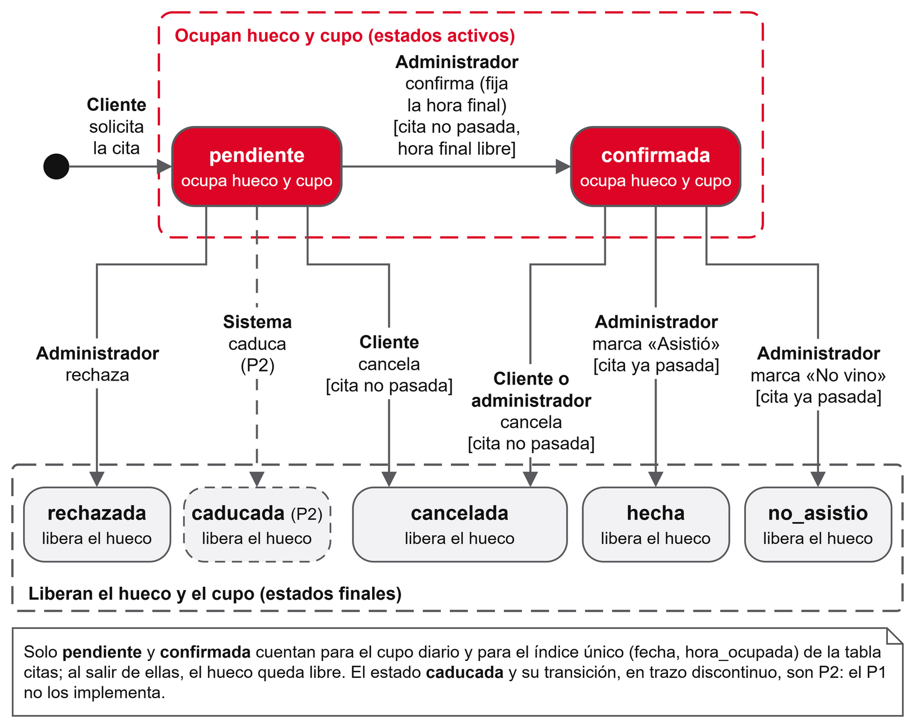

# 4. Descripción y objetivos

## 4.1 Descripción del prototipo

El prototipo tiene tres piezas que se comunican por la red local del ordenador de desarrollo:

- **App Android.** Escrita en Java con vistas XML y Material 3, sigue el patrón MVVM y funciona desde Android 8.0 (API 26). Es la única parte que ven los usuarios.
- **API REST.** Programa en Java 21 que usa el servidor HTTP que ya trae el JDK, sin frameworks. Recibe peticiones en JSON, aplica las reglas del negocio y es la única que habla con la base de datos.
- **Base de datos MySQL 9.7.** Guarda los usuarios, las invitaciones, el horario semanal, las excepciones de calendario y las citas, repartidos en cinco tablas.

La app reconoce dos tipos de usuario y muestra a cada uno su propio panel con una barra de navegación inferior.

El **cliente** entra con su @usuario y su contraseña. Si todavía no está aprobado, ve una pantalla de espera. Una vez aprobado, tiene tres pestañas. En «Mis citas» ve sus citas con su estado y puede cancelar las que siguen activas. En «Pedir cita» elige un día en un calendario de dos semanas que marca cada día como libre, completo o de vacaciones, y luego una hora entre las que quedan libres. «Ajustes» le permite cambiar entre tema claro y oscuro y cerrar la sesión.

El **barbero** (el administrador) tiene cuatro pestañas:

- **Solicitudes**, donde confirma cada cita pendiente con la hora pedida o con otra, o la rechaza.
- **Agenda**, con las citas confirmadas semana a semana. Cuando una ya ha pasado, marca si el cliente vino o no.
- **Horarios**, para fijar el tramo y el cupo de cada día de la semana, cerrar días por vacaciones o abrir un día suelto.
- **Clientes**, donde genera códigos de invitación, consulta su estado (pendiente, usado o caducado) y aprueba o bloquea a los clientes.

Una cita pasa por varios estados a lo largo de su vida (figura 1). Solo las pendientes y las confirmadas ocupan hueco y cuentan para el cupo del día, de modo que cancelar o rechazar una cita libera su hora en ese mismo momento.

*Figura 1. Diagrama de estados de una cita. Fuente: elaboración propia.*

El estado «caducada», que en la aplicación original marca las solicitudes que nadie respondió a tiempo, existe en la base de datos pero no lo asigna ningún proceso del prototipo. El barrido periódico que lo haría queda para una segunda fase.

## 4.2 Objetivo general

Desarrollar una aplicación Android, con su API y su base de datos, que permita a una barbería de un solo barbero gestionar sus citas con acceso por invitación, cupo diario y sin riesgo de reservas duplicadas.

## 4.3 Objetivos específicos

1. Diseñar una base de datos relacional en MySQL que impida por sí misma dos citas activas a la misma hora del mismo día.
2. Programar una API REST en Java, sin frameworks, que autentique a los usuarios con contraseñas protegidas y tokens firmados y que separe lo que puede hacer cada rol.
3. Asegurar que el cupo diario se respeta aunque varios clientes pidan cita a la vez, y demostrarlo con una prueba automática de hilos concurrentes.
4. Construir una app Android en Java con arquitectura MVVM que cubra las siete pantallas de cliente y barbero y que no bloquee el hilo principal con operaciones de red.
5. Comprobar el funcionamiento con pruebas unitarias y de integración y con un recorrido completo en el emulador, documentado con capturas.
