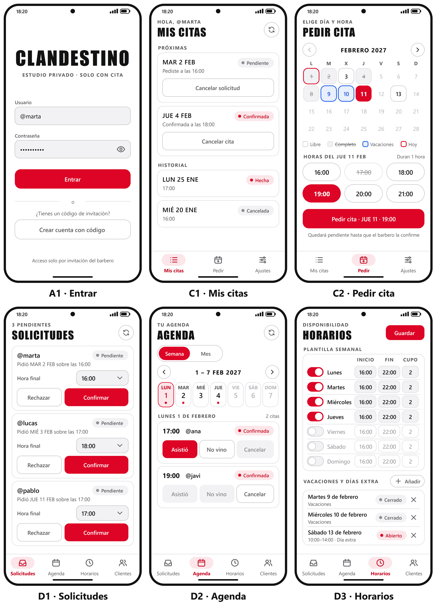
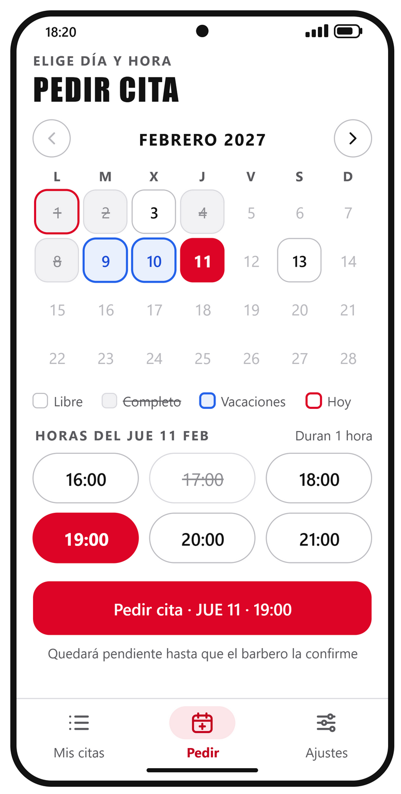
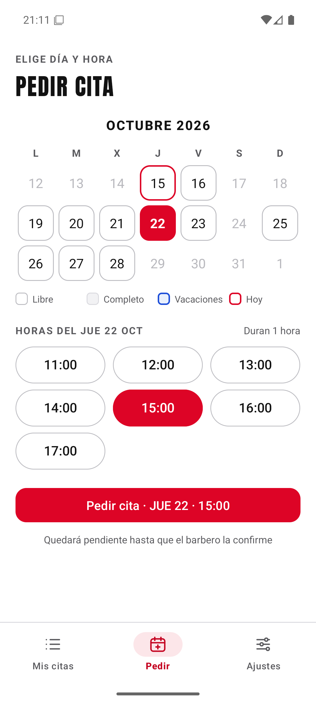
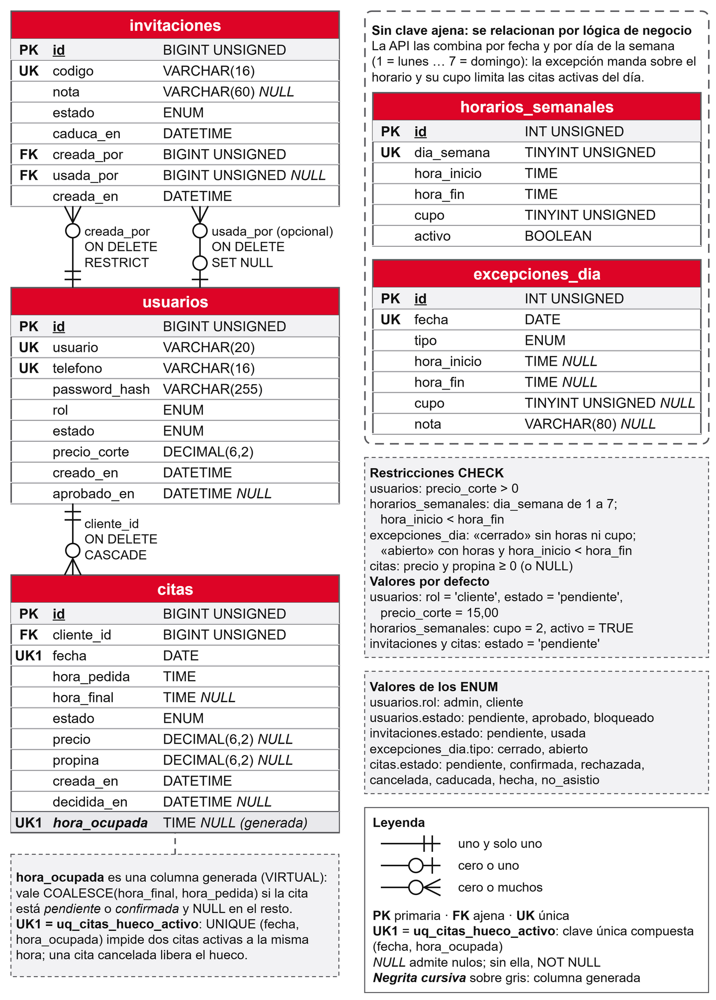
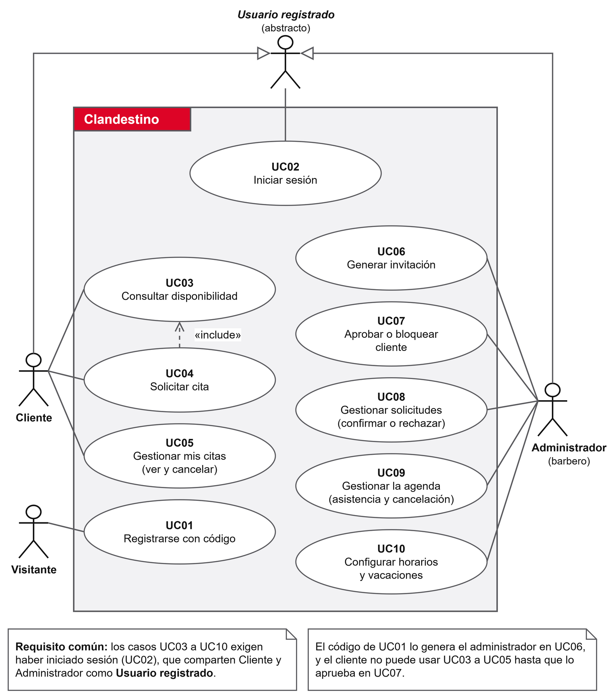

# 5. Contenidos

Este apartado recoge el diseño previo al código: cómo se iban a ver las pantallas, cómo se guardan los datos y qué puede hacer cada usuario. Los diagramas se dibujaron en draw.io y se actualizaron al terminar el desarrollo para que coincidan con lo programado.

## 5.1 Mockups

Antes de escribir los layouts se dibujaron once mockups, uno por pantalla y variante. La figura 2 reúne los seis que mejor resumen la aplicación. Los demás (registro, espera, bloqueo, ajustes y clientes) están en el anexo III.

*Figura 2. Mockups de las pantallas principales: entrada, mis citas y pedir cita del cliente; solicitudes, agenda y horarios del barbero. Fuente: elaboración propia.*

La identidad visual sale de la barbería real. Se usa el rojo de la marca para la acción principal de cada pantalla y blanco y grises para todo lo demás, y la fuente Anton solo en los títulos, en mayúsculas. Los componentes son los de Material 3 (botones, chips, barra de navegación inferior) con un tamaño táctil mínimo de 48 dp en los botones principales.

La versión final respeta los mockups casi por completo. El cambio más visible está en «Pedir cita». El mockup mostraba un mes entero con flechas para avanzar, pero el horizonte de reserva quedó fijado en dos semanas y el calendario de la app enseña solo esos días, sin flechas (figura 3). En la agenda del barbero pasó algo parecido, porque la vista mensual del mockup no se programó y quedó solo la semanal.

| Mockup | App en el emulador |
|---|---|
|  |  |

*Figura 3. Pantalla «Pedir cita»: mockup y captura de la app terminada. Fuente: elaboración propia.*

## 5.2 Modelo de datos

La base de datos tiene cinco tablas relacionadas (figura 4). Clientes y barbero comparten la tabla `usuarios` y se distinguen por el rol, porque en el negocio solo hay un barbero y una tabla aparte para él no aportaría nada.

*Figura 4. Diagrama entidad-relación de la base de datos `clandestino`. Fuente: elaboración propia.*

| Tabla | Qué guarda | Relaciones y restricciones principales |
|---|---|---|
| `usuarios` | Barbero y clientes: @usuario, teléfono, hash de la contraseña, rol, estado (pendiente, aprobado o bloqueado) y precio del corte | @usuario y teléfono únicos |
| `invitaciones` | Códigos de alta de un solo uso, con nota, estado y fecha de caducidad | `creada_por` y `usada_por` apuntan a `usuarios` |
| `citas` | Cada cita con su fecha, la hora pedida, la hora final que fija el barbero, el estado y el precio | `cliente_id` apunta a `usuarios`; índice único sobre la fecha y la hora ocupada |
| `horarios_semanales` | Tramo de apertura y cupo de cada día de la semana | Un registro por día, del 1 (lunes) al 7 (domingo) |
| `excepciones_dia` | Fechas sueltas que mandan sobre el horario semanal: vacaciones (cerrado) o días extra (abierto, con su tramo y su cupo) | Una excepción por fecha; una restricción `CHECK` exige que un día cerrado no tenga horas |

*Tabla 3. Tablas de la base de datos. Fuente: elaboración propia.*

El diseño tuvo que resolver un problema de MySQL. Se quería que no pudiera haber dos citas activas a la misma hora, pero sí varias canceladas o rechazadas en esa misma hora. La aplicación original usa PostgreSQL, que lo resuelve con un índice único parcial, y MySQL no tiene ese tipo de índice. La solución fue añadir a `citas` una columna generada, `hora_ocupada`, que vale la hora de la cita mientras está pendiente o confirmada y pasa a `NULL` en cuanto deja de estarlo. Como MySQL admite varios `NULL` en un índice único, el índice `uq_citas_hueco_activo (fecha, hora_ocupada)` solo vigila las citas activas (Oracle, 2026).

El precio se copia en la cita cuando el barbero marca que el cliente vino. Así un cambio de precio posterior no altera las citas ya cobradas.

## 5.3 Casos de uso

La figura 5 muestra los diez casos de uso del prototipo. Hay tres actores. El visitante es una persona con invitación que aún no tiene cuenta, y cliente y administrador heredan de «usuario registrado», que es quien inicia sesión. Pedir cita incluye siempre consultar antes la disponibilidad.

*Figura 5. Diagrama de casos de uso. Fuente: elaboración propia.*

La tabla 4 resume cada caso. La descripción completa, con los flujos alternativos y los códigos de error de la API, está en el anexo III.

| Caso | Actor | Precondición | Flujo principal | Resultado |
|---|---|---|---|---|
| UC01 Registrarse con código | Visitante | Tiene un código vigente | Escribe código, @usuario, teléfono y contraseña; la API valida la invitación y crea la cuenta | Cliente pendiente de aprobación; la invitación queda usada |
| UC02 Iniciar sesión | Usuario registrado | Tiene cuenta | Escribe @usuario y contraseña; la API devuelve un token que la app guarda cifrado | Entra a su panel o, si no está aprobado, a la pantalla de espera |
| UC03 Consultar disponibilidad | Cliente | Aprobado | Ve los días de las dos próximas semanas y, al elegir uno, sus horas libres | Ninguno, solo consulta |
| UC04 Solicitar cita | Cliente | Ha elegido una hora libre (incluye UC03) | La API comprueba horario, cupo y hueco y guarda la cita | Cita pendiente que ocupa hueco y cupo |
| UC05 Gestionar mis citas | Cliente | Aprobado | Ve sus citas y cancela una activa tras confirmar en un diálogo | Cita cancelada; hueco y cupo liberados |
| UC06 Generar invitación | Administrador | Sesión de barbero | Pulsa «Generar código», con una nota opcional | Código de 12 caracteres, válido 7 días y de un solo uso |
| UC07 Aprobar o bloquear cliente | Administrador | Hay clientes registrados | Elige un cliente y pulsa Aprobar o Bloquear | El cambio rige desde la siguiente petición del cliente |
| UC08 Gestionar solicitudes | Administrador | Hay citas pendientes | Confirma con la hora pedida u otra, o rechaza | Cita confirmada o rechazada |
| UC09 Gestionar la agenda | Administrador | Hay citas confirmadas | Marca «Asistió» o «No vino» en las pasadas y cancela las futuras | Cita hecha (con su precio), no asistida o cancelada |
| UC10 Configurar horarios y vacaciones | Administrador | Sesión de barbero | Edita tramo y cupo de cada día y añade o quita vacaciones y días extra | Los cambios afectan a UC03 y UC04 desde ese momento |

*Tabla 4. Resumen de los casos de uso. Fuente: elaboración propia.*
