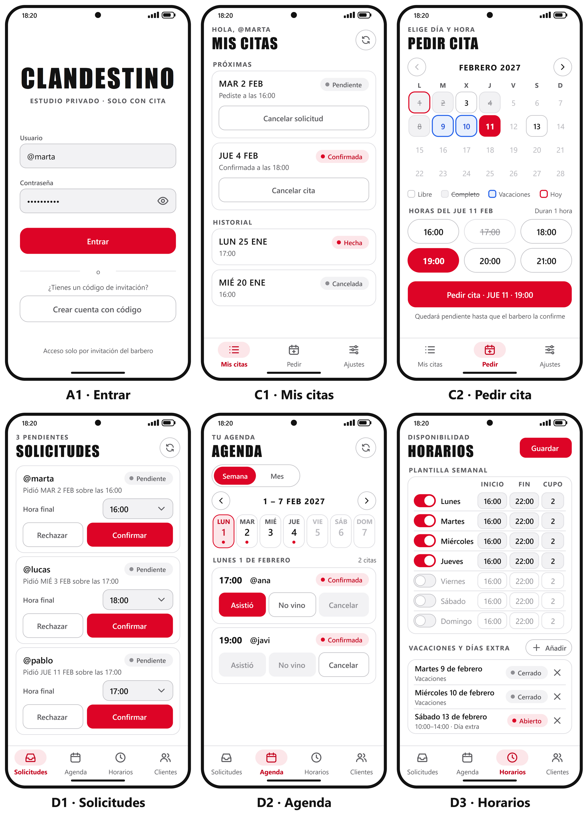
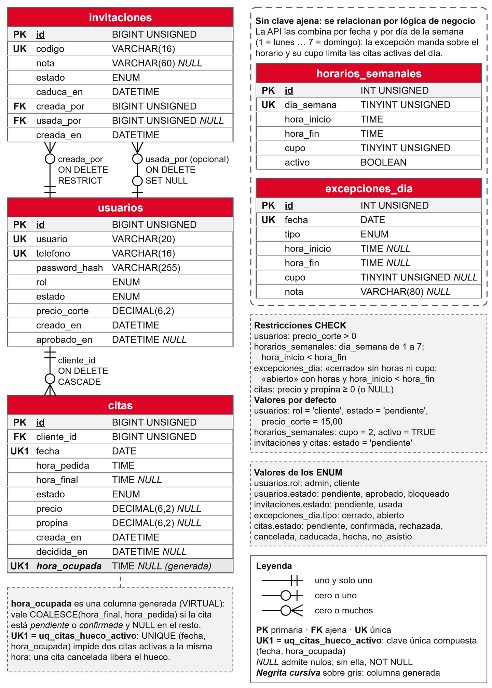
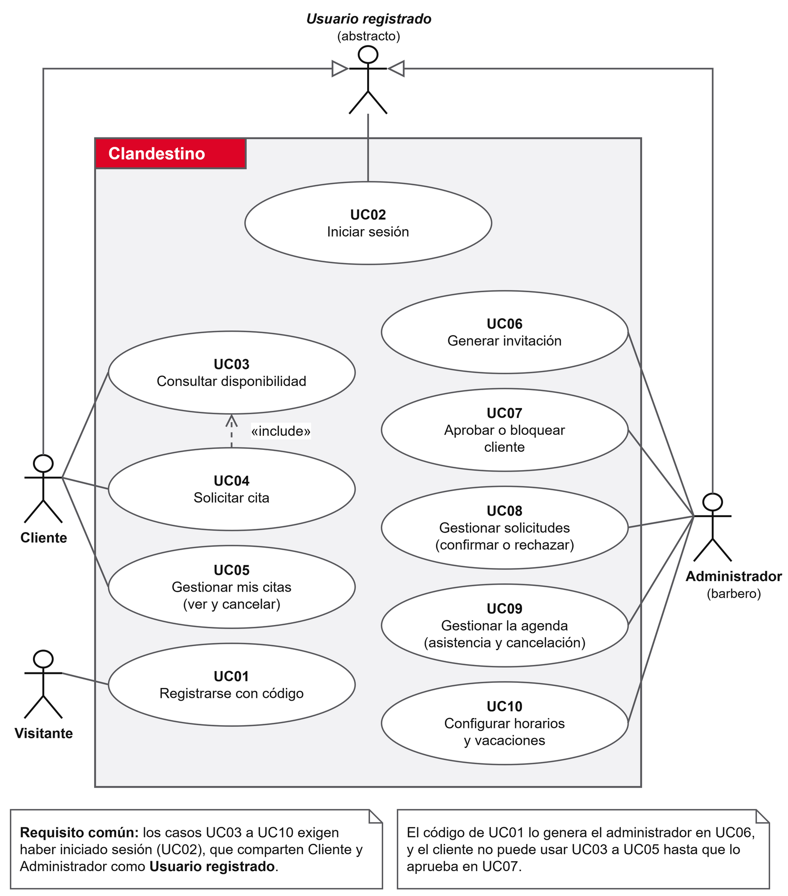

# 5. Contenidos

Este apartado recoge el diseño previo al código: cómo se iban a ver las pantallas, cómo se guardan los datos, qué puede hacer cada usuario y qué clases sostienen la lógica. Dibujé los diagramas en draw.io y los actualicé al terminar para que coincidan con lo programado.

## 5.1 Mockups

Antes de escribir los layouts dibujé once mockups, uno por pantalla y variante. La figura 1 reúne los seis principales, y los otros cinco están en el anexo III junto con la comparación entre el mockup de «Pedir cita» y la app terminada (figuras III.17 y III.18).

*Figura 1. Mockups de las pantallas principales: entrada, mis citas y pedir cita del cliente; solicitudes, agenda y horarios del barbero. Fuente: elaboración propia.*

La identidad visual es la que ya uso con mis clientes en la versión web. El rojo de la marca va en la acción principal de cada pantalla, el blanco y los grises en todo lo demás y la fuente Anton solo en los títulos. Cada pantalla tiene una sola tarea, para que un cliente que nunca la ha visto sepa qué hacer sin leer instrucciones, y los botones principales tienen un tamaño táctil mínimo de 48 dp. La app final respeta los mockups casi por completo. El calendario de «Pedir cita» enseña solo las dos semanas reservables, sin flechas de mes, y la agenda del barbero se quedó en vista semanal.

## 5.2 Modelo de datos

La base de datos tiene cinco tablas relacionadas (figura 2). Clientes y barbero comparten `usuarios` y se distinguen por el rol, porque solo hay un barbero. `invitaciones` guarda los códigos de alta de un solo uso, `citas` cada cita con su hora pedida, su hora final, su estado y su precio, `horarios_semanales` el tramo y el cupo de cada día de la semana y `excepciones_dia` las vacaciones y los días sueltos de apertura. La tabla III.12 del anexo III detalla las restricciones de cada una.

*Figura 2. Diagrama entidad-relación de la base de datos `clandestino`. Fuente: elaboración propia.*

Quería que no pudiera haber dos citas activas a la misma hora, pero sí varias canceladas o rechazadas en esa hora. La aplicación original usa PostgreSQL, que lo resuelve con un índice único parcial, y MySQL no tiene ese tipo de índice. Lo resolví con una columna generada, `hora_ocupada`, que vale la hora de la cita mientras está pendiente o confirmada y pasa a `NULL` cuando deja de estarlo. Como MySQL admite varios `NULL` en un índice único, el índice `uq_citas_hueco_activo (fecha, hora_ocupada)` solo vigila las citas activas (Oracle, 2026). El precio se copia en la cita al marcar la asistencia, para que un cambio de precio posterior no altere las citas ya cobradas.

## 5.3 Casos de uso

Hay tres actores (figura 3). El visitante es una persona con invitación que aún no tiene cuenta, y cliente y administrador heredan de «usuario registrado», que es quien inicia sesión. Pedir cita incluye siempre consultar antes la disponibilidad.

*Figura 3. Diagrama de casos de uso. Fuente: elaboración propia.*

| Caso | Actor | Qué hace y cómo termina |
|---|---|---|
| UC01 Registrarse con código | Visitante | Crea su cuenta con un código vigente y queda pendiente de aprobación |
| UC02 Iniciar sesión | Usuario registrado | Recibe un token que la app guarda cifrado y entra a su panel o a la espera |
| UC03 Consultar disponibilidad | Cliente | Ve los días de las dos próximas semanas y las horas libres de cada uno |
| UC04 Solicitar cita | Cliente | La API comprueba horario, cupo y hueco y guarda la cita pendiente |
| UC05 Gestionar mis citas | Cliente | Ve sus citas y cancela una activa, que libera su hueco |
| UC06 Generar invitación | Administrador | Obtiene un código de 12 caracteres, válido 7 días y de un solo uso |
| UC07 Aprobar o bloquear cliente | Administrador | Cambia el estado del cliente, que rige desde su siguiente petición |
| UC08 Gestionar solicitudes | Administrador | Confirma con la hora pedida u otra, o rechaza |
| UC09 Gestionar la agenda | Administrador | Marca si el cliente vino, cancela citas futuras y crea citas a mano |
| UC10 Configurar horarios | Administrador | Edita tramo y cupo de cada día, vacaciones y días extra |

*Tabla 2. Resumen de los casos de uso. Fuente: elaboración propia. La descripción completa, con flujos alternativos y errores de la API, está en el anexo III.*

## 5.4 Clases y métodos principales

La API se organiza en paquetes por capa y la app en pantallas, modelos de vista y repositorios. La tabla 3 recoge las clases que llevan la lógica, y la estructura de carpetas está en el apartado 7.6.

| Clase | Métodos clave | Qué hace |
|---|---|---|
| `Enrutador` (API) | `registrar`, `despachar` | Busca la ruta de cada petición, comprueba rol y estado y convierte los errores en JSON |
| `FiltroAutenticacion` (API) | `autenticar` | Valida el token de la cabecera y carga al usuario |
| `TokenJwt` y `Contrasenas` (API) | `emitir`, `validar`, `hashear`, `verificar` | Firman los tokens con HMAC y protegen las contraseñas con PBKDF2 |
| `ServicioCitas` (API) | `pedir`, `confirmar`, `rechazar`, `marcarAsistencia`, `crearManual` | Reglas de la cita, con el cerrojo por fecha que protege el cupo |
| `ServicioHorarios` (API) | `diasDelRango`, `huecos`, `guardarHorarios` | Calcula qué días y horas quedan libres según horario, excepciones y citas |
| `RepositorioCitasJdbc` (API) | consultas con `PreparedStatement` | Lee y escribe las citas en MySQL dentro de la transacción del servicio |
| `ClienteApi` (app) | `enviar` | Hace la petición HTTP en un hilo aparte y devuelve el resultado al hilo principal |
| `ModeloVistaPedirCita` (app) | carga de días y huecos, envío de la solicitud | Guarda el estado de la pantalla en `LiveData` y sobrevive al giro |

*Tabla 3. Clases y métodos principales. Fuente: elaboración propia.*
