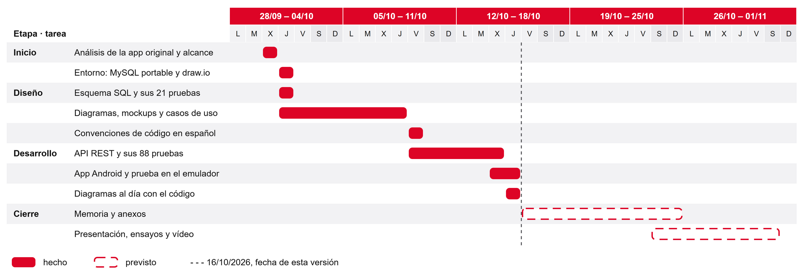

# 6. Metodología y planificación

## 6.1 Ciclo de vida

El proyecto sigue un ciclo de vida incremental. Primero se diseñó todo el sistema (datos, casos de uso, pantallas y contrato de la API) y después se construyó por piezas que se podían probar solas: la base de datos con sus pruebas, la API con las suyas y, por último, la app contra la API real. Cada incremento terminaba con algo que funcionaba y que el siguiente usaba sin cambios.

Para organizar el trabajo se tomaron algunas prácticas de Scrum (Schwaber y Sutherland, 2020) adaptadas a una sola persona. No tiene sentido hablar de equipo, de *Scrum Master* ni de reuniones diarias, pero sí de una lista de trabajo ordenada por prioridad, de ciclos cortos con un objetivo concreto y de una revisión al final de cada ciclo. Se eligió así porque los requisitos se fueron afinando sobre la marcha. Al dibujar los mockups o al escribir las pruebas aparecían detalles que el plan inicial no cerraba, como qué hacer con una hora que ya ha pasado o cuánto dura un token, y un modelo en cascada estricto no habría dejado volver atrás.

La lista de trabajo se ordenó en tres prioridades:

- **P1**, el prototipo mínimo que se entrega: el ciclo completo de la cita para cliente y barbero.
- **P2**, mejoras si sobraba tiempo: cita creada por el barbero, cambiar el @usuario, borrar clientes, copia de seguridad desde la app o caducidad automática de solicitudes.
- **P3**, opcional: un resumen mensual de ingresos y una caché local de las citas.

Al cierre de esta memoria está terminada la P1 completa. Las P2 y P3 pasan a trabajo futuro.

## 6.2 Obtención de requisitos

Los requisitos salieron del análisis de la aplicación web original, que ya está en uso en la barbería. Se revisaron su modelo de datos, sus pantallas y sus reglas de negocio, y se decidió qué se conservaba, qué se simplificaba y qué quedaba fuera. Los cambios más importantes respecto al original fueron estos:

- Todos entran con @usuario y contraseña. En la versión web el cliente se identificaba solo con su @usuario y su teléfono, y el barbero con correo y contraseña.
- Clientes y barbero comparten una sola tabla de usuarios, distinguidos por el rol.
- El precio se guarda en la cita al marcar la asistencia.
- El horizonte de reserva es fijo, de dos semanas.

Con eso se escribieron los casos de uso, 30 requisitos funcionales y 53 no funcionales, todos con identificador. Las 13 decisiones de detalle que el plan no resolvía (rango de fechas reservables, duración del token, límite de intentos, longitud de la contraseña, etc.) se anotaron en un documento de reglas de negocio para no decidirlas dos veces.

## 6.3 Planificación y tareas

El trabajo se repartió en las cuatro etapas que pide la guía del proyecto. La figura 6 muestra su desarrollo en el tiempo. Las barras macizas son el trabajo ya hecho, con las fechas del registro técnico, y las discontinuas lo que queda hasta la entrega.

*Figura 6. Diagrama de Gantt del proyecto. Fuente: elaboración propia.*

| Etapa | Tareas | Resultado |
|---|---|---|
| Inicio | Estudio de la aplicación original, definición del alcance, instalación del entorno (MySQL portable, draw.io, Android Studio) | Entorno funcionando y alcance cerrado |
| Diseño | Esquema SQL y sus pruebas, diagrama entidad-relación, casos de uso, requisitos, mockups, diagramas de clases y de secuencia iniciales, contrato de la API | Diseño completo antes de programar |
| Desarrollo | API con sus pruebas, app de cliente y de barbero, recorrido completo en el emulador, actualización de los diagramas | Prototipo P1 probado |
| Cierre | Memoria, anexos de instalación y de usuario, presentación y vídeo de la defensa | Entrega |

*Tabla 5. Etapas del proyecto. Fuente: elaboración propia.*

Las horas dedicadas a cada etapa fueron las siguientes:

| Etapa | Horas |
|---|---|
| Inicio | [completar] |
| Diseño | [completar] |
| Desarrollo | [completar] |
| Cierre | [completar] |
| **Total** | **[completar]** |

*Tabla 6. Horas dedicadas por etapa. Fuente: elaboración propia.*

## 6.4 Control de versiones y copias de seguridad

[completar: el repositorio Git todavía no está creado. Cuando exista, indicar aquí la URL del repositorio público de GitHub y cómo se han organizado los commits.]

El repositorio no incluye ningún secreto. Las claves de la base de datos, la firma del token y los usuarios de prueba están en un fichero `.env` excluido con `.gitignore`, y en su lugar se sube un `.env.example` con los nombres de las variables vacíos.

La base de datos se puede reconstruir en cualquier momento desde `database/schema.sql` y `database/seed.sql` con el script `scripts\bd.cmd`, que pide confirmación expresa antes de borrar nada. Los diagramas y los mockups también se pueden regenerar, porque cada uno sale de un script de Python que crea el fichero `.drawio` y lo exporta a PNG.

[completar: dónde y cada cuánto se ha hecho copia de la carpeta del proyecto, por ejemplo en la nube o en un disco externo.]
