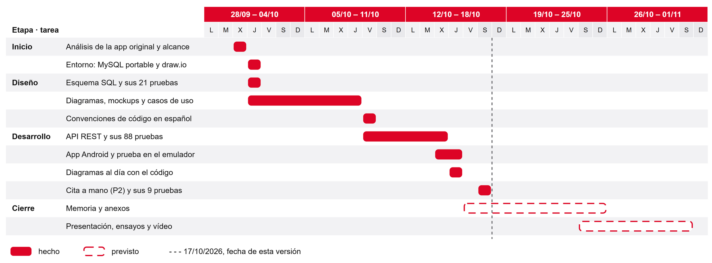

# 6. Metodología y planificación

## 6.1 Ciclo de vida

El proyecto sigue un ciclo de vida incremental. Primero diseñé todo el sistema (datos, casos de uso, pantallas y contrato de la API) y después lo construí por piezas que se podían probar solas: la base de datos con sus pruebas, la API con las suyas y, por último, la app contra la API real. Cada incremento terminaba con algo que funcionaba y que el siguiente usaba sin cambios.

Para organizarme tomé algunas prácticas de Scrum (Schwaber y Sutherland, 2020) adaptadas a una sola persona. Sin equipo ni reuniones diarias, me quedé con la lista de trabajo ordenada por prioridad, los ciclos cortos con un objetivo concreto y la revisión al final de cada uno, porque los requisitos se fueron afinando sobre la marcha. Al dibujar los mockups o al escribir las pruebas aparecían detalles que el plan no cerraba, como qué hacer con una hora que ya ha pasado o cuánto dura un token, y un modelo en cascada estricto no me habría dejado volver atrás.

La lista tenía tres prioridades. La **P1** era el prototipo mínimo con el ciclo completo de la cita, la **P2** las mejoras si sobraba tiempo (cita creada por el barbero, cambio de @usuario, borrado de clientes, copia de seguridad y caducidad de solicitudes) y la **P3** lo opcional (resumen mensual de ingresos y caché local). La P1 está terminada y, de la P2, la cita que crea el barbero.

## 6.2 Requisitos de partida

Para empezar necesitaba Android Studio con su emulador, el JDK 21, MySQL, draw.io y Git, además de lo aprendido en el ciclo sobre Java, Android, hilos y bases de datos. Los requisitos del producto salieron de mi propia forma de trabajar y de la aplicación web que ya uso. Revisé su modelo de datos, sus pantallas y sus reglas y decidí qué conservaba y qué simplificaba. Ahora todos entran con @usuario y contraseña, clientes y barbero comparten una tabla, el precio se guarda en la cita y el horizonte de reserva es fijo, de dos semanas. Las 14 decisiones de detalle que el plan no resolvía, como la duración del token o el límite de intentos, quedaron anotadas en un documento de reglas de negocio.

## 6.3 Planificación y tareas

Repartí el trabajo en las cuatro etapas que pide la guía (figura 4 y tabla 4). En el diagrama, las barras macizas son el trabajo hecho y las discontinuas lo que queda hasta la entrega.

*Figura 4. Diagrama de Gantt del proyecto. Fuente: elaboración propia.*

| Etapa | Tareas | Horas |
|---|---|---|
| Inicio | Estudio de la aplicación original, alcance e instalación del entorno | 6 |
| Diseño | Esquema SQL y sus pruebas, entidad-relación, casos de uso, requisitos, mockups, diagramas y contrato de la API | 14 |
| Desarrollo | API con sus pruebas, app de cliente y de barbero, recorrido en el emulador y cita a mano | 40 |
| Cierre | Memoria, anexos, presentación y vídeo de la defensa | 18 |
| **Total** | | **78** |

*Tabla 4. Estimación de dedicación por etapas. Fuente: elaboración propia.*

El proyecto se ha compaginado con el trabajo. La dedicación aproximada ha sido de 3 horas al día de lunes a viernes y de entre 2 y 4 horas en total durante cada fin de semana, repartidas según la disponibilidad. Esto supone entre 17 y 19 horas semanales. Para un periodo de unos 30 días, tomando como referencia 22 días laborables y cuatro fines de semana, el esfuerzo se sitúa entre 74 y 82 horas. La tabla utiliza 78 horas como estimación central (66 horas entre semana y 12 durante los fines de semana).

El reparto por etapas es aproximado y no procede de un registro horario. Incluye consultas de documentación, pruebas y correcciones. Las 18 horas de cierre contemplan también el ensayo y la grabación pendientes, de modo que el total corresponde al esfuerzo previsto para terminar el proyecto. Las fechas del diario sitúan los hitos documentados; cada bloque puede reunir trabajo de varias tardes y las fases pueden solaparse.

## 6.4 Control de versiones y copias de seguridad

El proyecto está en el repositorio público https://github.com/Jhonnatanospina/clandestino-tfg, en la rama `main`. El primer commit agrupa la versión inicial del TFG. Los dos siguientes añaden la dirección del repositorio a la documentación y el vídeo de respaldo de la demostración. El historial permite recuperar esas versiones, aunque concentrar tanto trabajo en el primer commit dificulta seguir los cambios pequeños. Las modificaciones posteriores deben guardarse en commits separados por tarea.

El repositorio no incluye ningún secreto, porque las claves están en un fichero `.env` excluido con `.gitignore` y solo se sube un `.env.example` con los nombres de las variables. La base de datos se reconstruye en cualquier momento desde `database/schema.sql` y `database/seed.sql` con `scripts\bd.cmd`, que pide confirmación antes de borrar nada, y los diagramas y mockups salen de scripts de Python que se pueden volver a ejecutar.

No consta una periodicidad de copias externas de la carpeta ni de los datos de uso. Los scripts recuperan la estructura y los datos iniciales, pero no las citas y los clientes añadidos después. Antes de utilizar la aplicación con datos reales habrá que guardar exportaciones periódicas con `mysqldump` fuera de la carpeta de trabajo y comprobar su restauración. Su automatización queda para la segunda fase.
