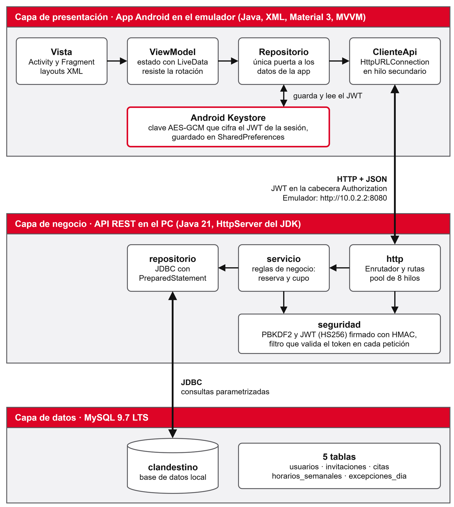
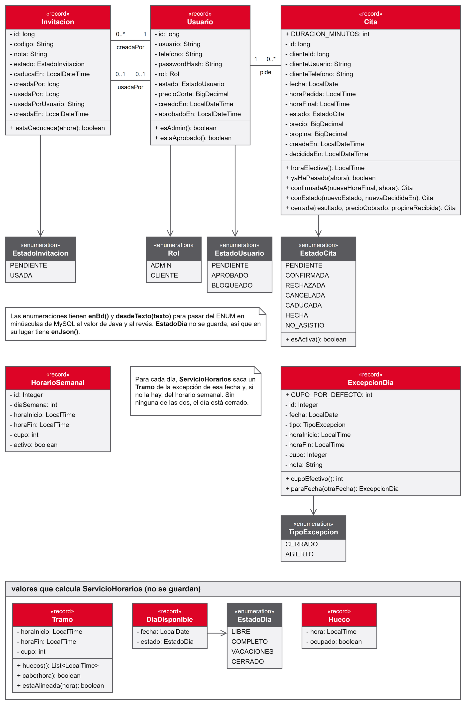
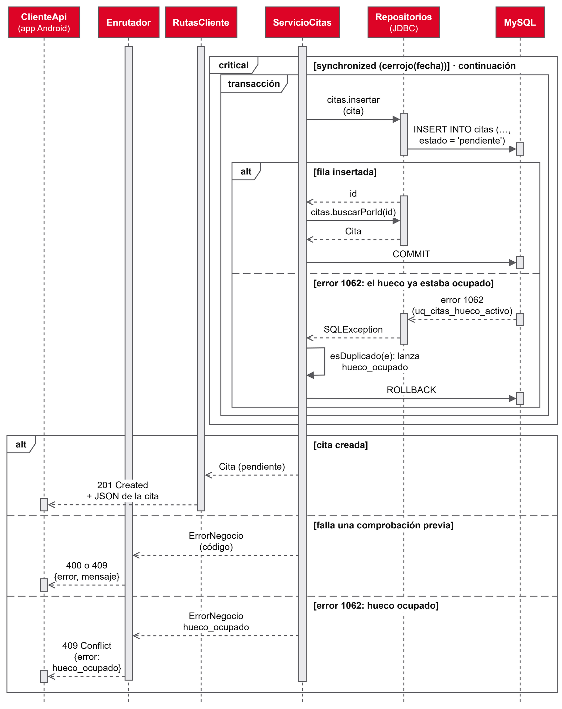

# 7. Desarrollo

## 7.1 Tecnologías y versiones

| Herramienta | Versión | Para qué se usa |
|---|---|---|
| Java (API) | 21 (`--release 21`) | Lenguaje de la API |
| Java (app) | 17 (nivel de código fuente) | Lenguaje de la app Android |
| Android Studio | Panda 4 (build 253.32098.37), con su JBR 21.0.10 | Entorno de desarrollo y emulador |
| Android Gradle Plugin / Gradle | 9.2.0 / 9.4.1 | Compilación de la app y de la API |
| SDK de Android | compileSdk 36.1, targetSdk 36, minSdk 26 | La app funciona desde Android 8.0 |
| AndroidX y Material | appcompat 1.8.0, material 1.14.0, recyclerview 1.4.0, swiperefreshlayout 1.2.0, lifecycle 2.11.0 | Interfaz, listas y MVVM |
| MySQL Community | 9.7.2 LTS (instalación portable) | Base de datos |
| MySQL Connector/J | 9.7.0 | Driver JDBC de la API |
| org.json | 20260814 (en Android ya viene incluido) | Lectura y escritura de JSON |
| JUnit | 6.1.3 (API) y 4.13.2 (app) | Pruebas automáticas |
| draw.io | 31.5.3 | Diagramas y mockups |

*Tabla 7. Tecnologías y versiones utilizadas. Fuente: elaboración propia.*

La API no usa ningún framework web. El servidor es el `HttpServer` que trae el propio JDK (Oracle, s. f.-a) y el acceso a datos se hace con JDBC y `PreparedStatement` (Oracle, s. f.-b). Se eligió así para programar a mano lo que un framework daría hecho (rutas, filtros, conversión a JSON, transacciones) y poder explicarlo en la defensa. Lo mismo pasa en la app, que usa `HttpURLConnection` en lugar de una librería como Retrofit.

## 7.2 Arquitectura

El sistema tiene tres capas (figura 7). La app solo conoce la API, y la API es la única que entra en la base de datos con un usuario de MySQL que únicamente puede leer, insertar, modificar y borrar filas. Ese usuario no puede crear ni borrar tablas.



*Figura 7. Arquitectura del sistema en tres capas. Fuente: elaboración propia.*

**La API** se organiza en paquetes por capa:

- `http`: servidor, `Enrutador`, rutas de cada rol y conversión a JSON.
- `seguridad`: contraseñas, token, filtro de autenticación y limitador de intentos.
- `servicio`: las reglas del negocio.
- `repositorio`: consultas JDBC, detrás de interfaces.
- `modelo`: los datos.

Una petición entra por el `Enrutador`, que busca la ruta y pasa la cabecera al filtro de autenticación. El filtro valida el token y carga al usuario, y con ese usuario el `Enrutador` comprueba el rol y el estado. Después la ruta llama al servicio, y este al repositorio. Si una regla no se cumple, el servicio lanza un `ErrorNegocio` con su código HTTP y el `Enrutador` lo convierte en una respuesta `{"error", "mensaje"}`, así que la app recibe siempre el mismo formato de error.

**La app** sigue el patrón MVVM que recomienda la guía de arquitectura de Android (Android Developers, 2026c). Cada pantalla (`Activity` o `Fragment`) observa un `ViewModel`, que guarda el estado en `LiveData` y sobrevive a la rotación. El `ViewModel` pide los datos a un repositorio y este a `ClienteApi`, que hace la petición HTTP en un hilo secundario y devuelve el resultado al hilo principal con un `Handler`, ya que Android no permite usar la red en el hilo de la interfaz (Android Developers, 2026b). La app tiene 5 actividades, 7 fragmentos, un diálogo y 8 `ViewModel`.

La figura 8 muestra el modelo de clases de la API. Los diagramas de clases completos de la API y de la app (figuras III.1 a III.6) y el resto de secuencias de «Solicitar cita» (figuras III.7 a III.10) están en el anexo III. Se rehicieron al final a partir de las clases compiladas, con `javap`, para que tengan los mismos nombres que el código.



*Figura 8. Diagrama de clases del modelo de la API. Fuente: elaboración propia.*

## 7.3 Requisitos

Los requisitos se escribieron en la fase de diseño, con un identificador cada uno para poder seguirlos hasta el código:

- **30 requisitos funcionales** de la primera fase (RF-01 a RF-30), todos implementados. La tabla de trazabilidad del anexo III relaciona cada caso de uso con su pantalla, sus rutas de la API y sus requisitos.
- **13 requisitos funcionales de segunda fase** (RF-P2) y **3 de tercera** (RF-P3), que quedan como trabajo futuro.
- **53 requisitos no funcionales** repartidos en seguridad (13), rendimiento (8), usabilidad (11), compatibilidad (7), mantenibilidad (8) y privacidad (6).

No todos los no funcionales se han cumplido. Los que quedan pendientes se indican en el apartado 7.7.

## 7.4 Seguridad

La seguridad se diseñó siguiendo OWASP MASVS 2.1.0 para la app (OWASP Mobile Application Security, 2024) y la guía de OWASP sobre almacenamiento de contraseñas para la API (OWASP Cheat Sheet Series, s. f.).

| Categoría MASVS | Qué hace Clandestino |
|---|---|
| STORAGE (almacenamiento) | El token de sesión se guarda cifrado con AES-GCM y una clave que vive en el Android Keystore y no puede extraerse del dispositivo (Android Developers, 2026a). La copia de seguridad automática de Android está desactivada (`allowBackup="false"`). |
| CRYPTO (criptografía) | Las contraseñas se guardan con PBKDF2-HMAC-SHA256, 600.000 iteraciones, sal aleatoria de 16 bytes y comparación en tiempo constante. El token se firma con HMAC-SHA256 y una clave de al menos 32 bytes. |
| AUTH (autenticación) | El rol y el estado se comprueban siempre en el servidor, nunca solo en la app. El token caduca a los 7 días. Tras 5 intentos fallidos en 15 minutos, la API responde 429. Un usuario inexistente tarda lo mismo en responder que una contraseña equivocada (775 ms medidos), así que por el tiempo no se puede saber qué cuentas existen. |
| NETWORK (red) | En la versión de depuración solo se permite HTTP sin cifrar hacia `10.0.2.2` y `localhost`, mediante la configuración de seguridad de red (Android Developers, 2026d). La versión de publicación no tiene esa excepción, pero el prototipo aún no tiene HTTPS (apartado 7.7). |
| CODE (código) | Todas las consultas usan `PreparedStatement`, lo que evita la inyección SQL. La API vuelve a validar cada dato aunque la app ya lo haya hecho y rechaza los cuerpos de más de 16 KiB. |
| PRIVACY (privacidad) | Solo se piden @usuario, teléfono y contraseña. El registro muestra un aviso de privacidad, como exige el RGPD (Reglamento (UE) 2016/679, 2016), y el cliente no ve los precios ni los datos de otros clientes. |

*Tabla 8. Medidas de seguridad según las categorías de OWASP MASVS. Fuente: elaboración propia a partir de OWASP Mobile Application Security (2024).*

El JWT se programó a mano con la clase `Mac` de Java, siguiendo la RFC 7519 (Jones et al., 2015) y las recomendaciones de la RFC 8725 (Sheffer et al., 2020): la API solo acepta el algoritmo HS256 y rechaza cualquier otro que venga en la cabecera del token.

Las 600.000 iteraciones de PBKDF2 son la cifra que recomienda OWASP para HMAC-SHA256. En el ordenador de desarrollo cada cálculo tarda unos 0,75 s de media (mínimo 529 ms y máximo 2.109 ms en 8 mediciones), un coste que se paga solo al iniciar sesión y al registrarse. Por eso el servidor atiende con un grupo de 8 hilos, ya que con uno solo un inicio de sesión dejaría en espera a todas las demás peticiones.

## 7.5 Concurrencia: el cupo diario

El caso más delicado del proyecto aparece cuando dos clientes piden cita para el mismo día a la vez. El índice único de la base de datos impide que dos citas activas ocupen la misma hora (apartado 5.2), pero no puede impedir que se supere el cupo del día, porque ningún índice cuenta filas. Si dos peticiones cuentan las citas del día al mismo tiempo, las dos ven que queda sitio y las dos insertan.

`ServicioCitas` lo resuelve con un bloque `synchronized` sobre un objeto cerrojo por fecha, que se guarda en un `ConcurrentHashMap`. Dentro del bloque van, en una sola transacción, la cuenta de citas activas, la inserción y el `COMMIT`. Las peticiones del mismo día se ponen en fila y las de días distintos no se esperan entre sí. Si aun así llegaran dos citas a la misma hora, el índice único de MySQL las frena con el error 1062, que la API traduce a `409 hueco_ocupado`.

La prueba `PruebaConcurrenciaCupo` lo demuestra. Lanza 5 hilos que salen a la vez gracias a un `CountDownLatch` y piden cita para el mismo día. Para que la carrera ocurra siempre y no por casualidad, el repositorio se envuelve en uno «lento» que espera 300 ms después de contar.

| Caso | Resultado |
|---|---|
| Cupo 1, horas distintas, sin `synchronized` | Se crean 5 citas en un día con cupo 1 |
| Cupo 1, horas distintas, con `synchronized` | Se crea 1 cita; las otras 4 reciben `dia_lleno` |
| Cupo 5, misma hora, sin `synchronized` | Se crea 1 cita; las otras 4 reciben `hueco_ocupado` gracias al índice único |

*Tabla 9. Resultados de la prueba de concurrencia del cupo. Fuente: elaboración propia.*

La figura 9 muestra el final de la secuencia de «Solicitar cita» en la API, con el cerrojo, la transacción y el camino del error 1062.



*Figura 9. Diagrama de secuencia de la inserción de una cita en la API. Fuente: elaboración propia.*

El cerrojo vive en la memoria del proceso. Si algún día se ejecutaran dos copias de la API, habría que llevar el bloqueo a la base de datos, por ejemplo con `SELECT ... FOR UPDATE` sobre una fila por fecha.

## 7.6 Diario de desarrollo

El diario completo está en el anexo V. Estas son las entradas que mejor muestran cómo avanzó el trabajo y qué problemas aparecieron.

**30-09-2026 · Inicio.** Se revisó la aplicación original y se cerró el alcance. Se dejaron fuera las métricas, las nóminas y los avisos para centrar el esfuerzo en el ciclo de la cita.

**01-10-2026 · Entorno y base de datos.** Se instaló MySQL 9.7.2 en modo portable, para que solo consuma memoria mientras se trabaja en el proyecto. El primer problema de diseño fue que MySQL no tiene índices únicos parciales, y se resolvió con la columna generada `hora_ocupada`. Las 21 pruebas del esquema dieron el resultado esperado.

**01-10-2026 · Diseño.** Se dibujaron los diagramas y los mockups y se escribieron los casos de uso y los requisitos. Una revisión de coherencia entre las piezas encontró 12 fallos. Entre ellos, un mockup enseñaba el precio al cliente aunque la API no se lo envía y el diagrama de casos de uso no tenía el actor Visitante. Se corrigieron antes de empezar a programar.

**09-10-2026 · Primera clase.** Se decidió escribir todo el código en español y se renombraron diagramas y documentos. La primera clase fue `Contrasenas`, y con ella se midió el coste de PBKDF2.

**14-10-2026 · API terminada.** La API quedó completa con 88 pruebas en verde. Durante el desarrollo aparecieron varios problemas. `HttpServer` atiende en un solo hilo si no se le asigna un `Executor`, y solo reparte las peticiones por prefijo, lo que obligó a escribir un `Enrutador` propio para rutas como `/api/citas/{id}/cancelar`. org.json borra un campo al asignarle `null` y quita los ceros de `15.00`. Sin `ResolverStyle.STRICT`, el 30 de febrero se convierte sin avisar en el 2 de marzo. La prueba de concurrencia confirmó que sin `synchronized` entran 5 citas en un día con cupo 1.

**15-10-2026 · App en el emulador.** Se recorrió el flujo completo con datos reales: invitación, registro, aprobación, solicitud, confirmación con otra hora y agenda. El problema más difícil fue que las horas de «Pedir cita» salían pegadas a la izquierda aunque el estilo pedía centrarlas. Un registro de depuración mostró que Android ignoraba `textAlignment` en toda la app porque el manifiesto tenía `supportsRtl="false"`.

**15-10-2026 · Diagramas al día.** Los diagramas de clases y de secuencia se rehicieron a partir del código compilado. El diagrama de secuencia atribuía al filtro de autenticación la comprobación del rol, que en realidad hace el `Enrutador`, y se corrigió el diagrama en lugar del código.

## 7.7 Organización de carpetas

```
clandestino-tfg/
├─ api/        API REST (Gradle). Paquetes http, seguridad, servicio,
│              repositorio, modelo y herramientas (CrearAdmin)
├─ android/    App Android (Gradle). Paquetes ui (acceso, cliente, admin),
│              modelovista, datos (remoto, repositorio), modelo y utilidades
├─ database/   schema.sql, seed.sql y pruebas del esquema
├─ scripts/    Arranque y parada de MySQL, carga de la base y usuario de la app
└─ docs/       Diseño, diagramas, mockups, capturas y memoria
```

Las claves (base de datos, firma del token y usuarios de prueba) están en un fichero `.env` que no se sube al repositorio. Hay un `.env.example` con los nombres de las variables y sin valores.

## 7.8 Pruebas

| Conjunto | Qué comprueba | Resultado |
|---|---|---|
| Esquema de la base de datos (21 pruebas SQL) | Índice único de citas activas, restricciones `CHECK`, claves foráneas y sus reglas de borrado | 21 de 21 correctas |
| API, pruebas unitarias | Contraseñas, token, limitador de intentos, tramos y huecos, reglas de horario, normalización de datos y JSON | 88 de 88 en verde (unitarias e integración juntas) |
| API, pruebas de integración contra MySQL | Servicio de citas (24 pruebas), servicio de usuarios, concurrencia del cupo y la API completa por HTTP | |
| App, pruebas unitarias | Lectura de modelos desde JSON, calendario, formatos de fecha y validaciones | 25 de 25 en verde |
| Recorrido manual en el emulador | Flujo completo de cliente y barbero, tema oscuro y cierre de sesión | Correcto, con 14 capturas |

*Tabla 10. Resumen de las pruebas. Fuente: elaboración propia.*

Las pruebas de integración usan una base de datos aparte (`clandestino_api_test`) y un reloj que se puede mover, para comprobar reglas como «no se puede pedir una hora pasada» sin depender de la hora real. Los casos de prueba manuales, con sus pasos y su resultado, están en el anexo IV. El análisis estático de Android (lint) no da errores y deja 4 avisos de configuración, sobre versiones de dependencias y reglas de extracción de datos.

Algunas comprobaciones previstas en el plan no se llegaron a hacer:

- No hay pruebas instrumentadas de interfaz (Espresso).
- No se ha medido el rendimiento de la consulta de huecos con `EXPLAIN` ni se ha usado `StrictMode`.
- La app no tiene animaciones propias ni diseño específico para horizontal o tableta.
- La comunicación entre app y API no va cifrada con HTTPS.

Se recogen como mejoras en las conclusiones.

## 7.9 Relación con los módulos del ciclo

| Módulo | Dónde se aplica |
|---|---|
| Programación multimedia y dispositivos móviles | Actividades y su ciclo de vida (registrado con `Log.i`), fragmentos, `RecyclerView`, diálogos, `SharedPreferences`, `onSaveInstanceState` en «Pedir cita», `HttpURLConnection` en hilo secundario, Material 3 |
| Programación de servicios y procesos | Servidor HTTP con grupo de hilos, `synchronized` en la sección crítica del cupo, prueba de hilos con `CountDownLatch`, hash de contraseñas y firma HMAC |
| Bases de datos | Modelo entidad-relación, restricciones, columna generada con índice único, transacciones, usuario sin privilegios de administración |
| Acceso a datos | JDBC con `PreparedStatement`, patrón repositorio, transacciones, JSON sobre HTTP |
| Programación | Programación orientada a objetos en Java: interfaces, `enum`, `record`, excepciones propias, colecciones |
| Desarrollo de interfaces | Mockups, layouts XML, tema claro y oscuro, validación en vivo, accesibilidad básica, manual de usuario |
| Entornos de desarrollo | Android Studio, Gradle, JUnit, UML con draw.io, lint |
| Empresa e iniciativa emprendedora | Análisis de mercado y propuesta de valor (apartado 3.4) |

*Tabla 11. Aplicación de los módulos del ciclo en el proyecto. Fuente: elaboración propia.*
