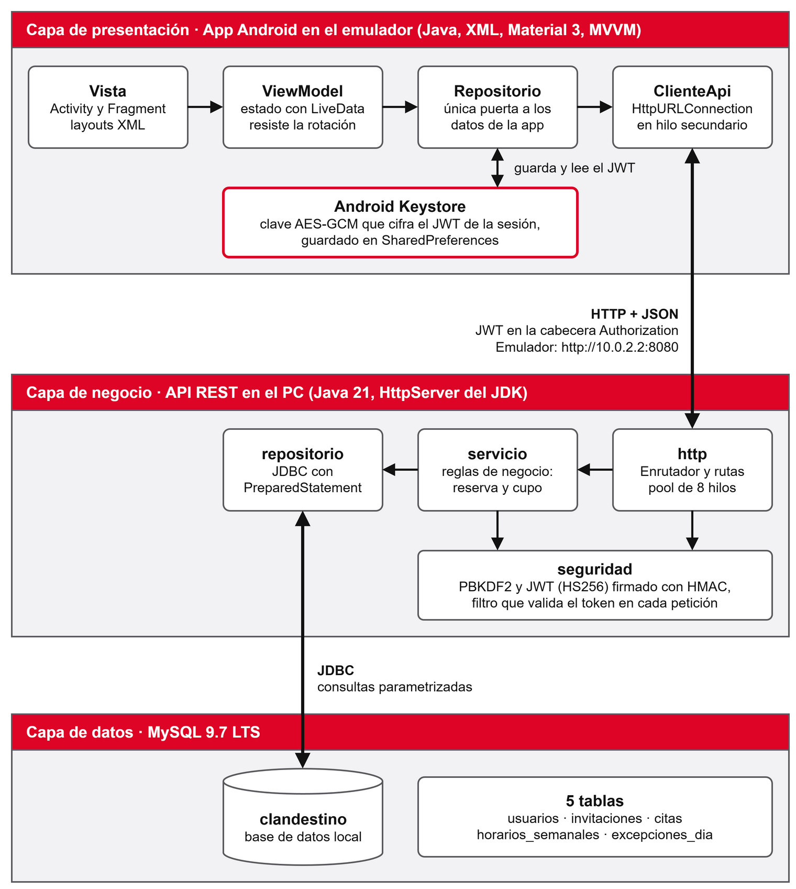
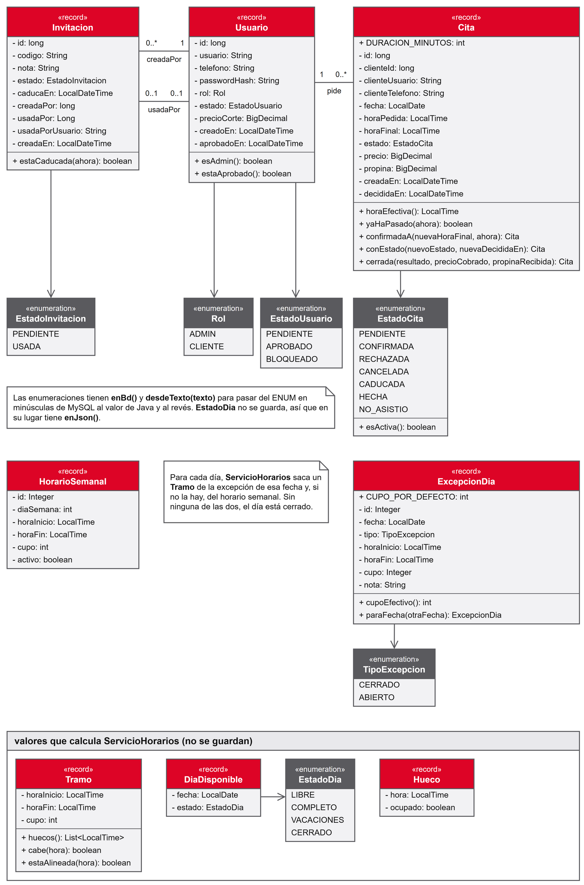

# 7. Desarrollo

## 7.1 Tecnologías y versiones

| Herramienta | Versión | Para qué y por qué |
|---|---|---|
| Java | 21 en la API y 17 en la app | Lenguaje principal del ciclo y uno de los dos nativos de Android |
| Android Studio | Panda 4, con su JBR 21.0.10 | Entorno oficial de Android, con emulador incluido |
| Gradle y Android Gradle Plugin | 9.4.1 y 9.2.0 | Compilan la app y la API con las mismas herramientas |
| SDK de Android | compileSdk 36.1, targetSdk 36, minSdk 26 | La app funciona desde Android 8.0 |
| AndroidX y Material | appcompat 1.8.0, material 1.14.0, lifecycle 2.11.0 | Componentes de Material 3, listas y MVVM |
| MySQL y Connector/J | 9.7.2 LTS portable y 9.7.0 | Base relacional del módulo de Bases de datos, accedida por JDBC |
| org.json y JUnit | 20260814; JUnit 6.1.3 (API) y 4.13.2 (app) | JSON sin dependencias pesadas y pruebas automáticas |
| draw.io | 31.5.3 | Diagramas UML y mockups |

*Tabla 5. Tecnologías y versiones utilizadas. Fuente: elaboración propia.*

La API no usa ningún framework web. El servidor es el `HttpServer` que trae el JDK (Oracle, s. f.-a) y los datos se leen con JDBC y `PreparedStatement` (Oracle, s. f.-b). Lo elegí así para programar a mano lo que un framework daría hecho (rutas, filtros, JSON y transacciones) y poder explicarlo en la defensa. Por lo mismo, la app usa `HttpURLConnection` en lugar de Retrofit.

## 7.2 Arquitectura y diagrama de clases

El sistema tiene tres capas (figura 5). La app solo conoce la API, y la API entra en la base de datos con un usuario de MySQL que puede leer y modificar filas pero no crear ni borrar tablas.



*Figura 5. Arquitectura del sistema en tres capas. Fuente: elaboración propia.*

En la API, una petición entra por el `Enrutador`, que pasa la cabecera al filtro de autenticación y con el usuario ya cargado comprueba el rol y el estado. Después la ruta llama al servicio y este al repositorio. Si una regla no se cumple, el servicio lanza un `ErrorNegocio` con su código HTTP y el `Enrutador` lo convierte en `{"error", "mensaje"}`, así que la app recibe siempre el mismo formato. La app sigue el patrón MVVM que recomienda Android (Android Developers, 2026c). Cada pantalla observa un `ViewModel` que guarda el estado en `LiveData`, y este pide los datos a un repositorio que usa `ClienteApi` en un hilo secundario, porque Android no permite usar la red en el hilo de la interfaz (Android Developers, 2026b).

La figura 6 muestra el modelo de clases de la API. Los diagramas completos de la API y de la app están en el anexo III (figuras III.1 a III.6), y los rehíce al final a partir de las clases compiladas para que tengan los mismos nombres que el código.



*Figura 6. Diagrama de clases del modelo de la API. Fuente: elaboración propia.*

## 7.3 Requisitos funcionales y no funcionales

Escribí los requisitos en la fase de diseño, cada uno con su identificador. Hay **30 funcionales** de la primera fase (RF-01 a RF-30), todos implementados, y el anexo III relaciona cada caso de uso con su pantalla, sus rutas y sus requisitos. De los 13 de segunda fase está hecha la cita a mano (RF-P2-02). Los **53 no funcionales** se reparten en seguridad (13), rendimiento (8), usabilidad (11), compatibilidad (7), mantenibilidad (8) y privacidad (6), y los que no he cumplido se indican en el apartado 7.7.

Los de seguridad siguen OWASP MASVS 2.1.0 (OWASP Mobile Application Security, 2024) y la guía de OWASP sobre contraseñas (OWASP Cheat Sheet Series, s. f.), y la tabla III.13 del anexo III los detalla por categoría. Las contraseñas se guardan con PBKDF2-HMAC-SHA256 y 600.000 iteraciones, y el token de sesión es un JWT que programé a mano con la clase `Mac` siguiendo la RFC 7519 (Jones et al., 2015) y la RFC 8725 (Sheffer et al., 2020), de modo que la API solo acepta HS256. La app guarda el token cifrado con una clave del Android Keystore (Android Developers, 2026a), y tras 5 intentos fallidos en 15 minutos la API responde 429. Cada cálculo de PBKDF2 tarda unos 0,75 s en mi ordenador, así que el servidor atiende con 8 hilos para que un inicio de sesión no deje en espera a las demás peticiones.

## 7.4 Concurrencia: el cupo diario

El caso más delicado aparece cuando dos clientes piden cita para el mismo día a la vez. El índice único impide dos citas activas a la misma hora (apartado 5.2), pero ningún índice cuenta filas, así que no puede impedir que se supere el cupo. Si dos peticiones cuentan las citas del día al mismo tiempo, las dos ven sitio y las dos insertan.

`ServicioCitas` lo resuelve con un bloque `synchronized` sobre un cerrojo por fecha guardado en un `ConcurrentHashMap`. Dentro van, en una sola transacción, la cuenta de citas activas, la inserción y el `COMMIT`. Las peticiones del mismo día se ponen en fila, las de días distintos no se esperan, y si aun así llegaran dos citas a la misma hora, MySQL las frena con el error 1062, que la API traduce a `409 hueco_ocupado`. La prueba `PruebaConcurrenciaCupo` lanza 5 hilos a la vez con un `CountDownLatch` y un repositorio «lento» que espera 300 ms después de contar, para que la carrera ocurra siempre (tabla 6). El diagrama de secuencia de esta parte es la figura III.11 del anexo III.

| Caso | Resultado |
|---|---|
| Cupo 1, horas distintas, sin `synchronized` | Se crean 5 citas en un día con cupo 1 |
| Cupo 1, horas distintas, con `synchronized` | Se crea 1 cita y las otras 4 reciben `dia_lleno` |
| Cupo 5, misma hora, sin `synchronized` | Se crea 1 cita y las otras 4 reciben `hueco_ocupado` gracias al índice único |

*Tabla 6. Resultados de la prueba de concurrencia del cupo. Fuente: elaboración propia.*

El cerrojo vive en la memoria del proceso. Con dos copias de la API habría que llevar el bloqueo a la base de datos, por ejemplo con `SELECT ... FOR UPDATE` sobre una fila por fecha.

## 7.5 Diario de desarrollo

El diario completo está en el anexo V. Estas son las entradas con los problemas que más me enseñaron.

**30-09 y 01-10 · Inicio y diseño.** Cerré el alcance y dejé fuera métricas, nóminas y avisos. MySQL no tiene índices únicos parciales y lo resolví con la columna `hora_ocupada`. Una revisión de coherencia entre diagramas, mockups y requisitos encontró 12 fallos, como un mockup que enseñaba el precio al cliente, y los corregí antes de programar.

**09-10 a 14-10 · API.** Decidí escribir todo el código en español. `HttpServer` atiende en un solo hilo si no se le da un `Executor` y solo reparte por prefijo, lo que me obligó a escribir un `Enrutador` propio para rutas como `/api/citas/{id}/cancelar`. Sin `ResolverStyle.STRICT`, el 30 de febrero se convertía en el 2 de marzo. La API quedó con 88 pruebas en verde.

**15-10 · App en el emulador.** Recorrí el flujo completo con datos reales. Las horas de «Pedir cita» salían pegadas a la izquierda, y un registro de depuración mostró que Android ignoraba `textAlignment` porque el manifiesto tenía `supportsRtl="false"`.

**17-10 · Cita a mano.** Hice la primera función de la segunda fase, la cita que el barbero mete para quien llama por teléfono, con 9 pruebas nuevas. Lo más delicado fue el giro de pantalla, porque el diálogo tenía que conservar lo elegido sin que el desplegable filtrara la lista de clientes.

## 7.6 Organización de carpetas

```
clandestino-tfg/
├─ api/        API REST (Gradle): http, seguridad, servicio, repositorio y modelo
├─ android/    App Android (Gradle): ui, modelovista, datos, modelo y utilidades
├─ database/   schema.sql, seed.sql y pruebas del esquema
├─ scripts/    Arranque de MySQL, carga de la base y usuario de la app
└─ docs/       Diseño, diagramas, mockups, capturas y memoria
```

Las claves están en un `.env` que no se sube al repositorio, y el `.env.example` recoge los nombres de las variables sin valores.

## 7.7 Pruebas

| Conjunto | Qué comprueba | Resultado |
|---|---|---|
| Esquema (21 pruebas SQL) | Índice único de citas activas, restricciones `CHECK` y claves foráneas | 21 de 21 correctas |
| API, unitarias e integración contra MySQL | Contraseñas, token, limitador, huecos, horarios, servicio de citas (32 pruebas), usuarios, concurrencia y la API completa por HTTP | 97 de 97 en verde |
| App, unitarias | Modelos desde JSON, calendario, fechas, validaciones y horas del desplegable | 26 de 26 en verde |
| Recorrido manual en el emulador | Flujo completo de cliente y barbero, cita a mano, tema oscuro y cierre de sesión | Correcto, con 17 capturas |

*Tabla 7. Resumen de las pruebas. Fuente: elaboración propia.*

Las pruebas de integración usan una base de datos aparte y un reloj que se puede mover, para comprobar reglas como «no se puede pedir una hora pasada» sin depender de la hora real. Los casos manuales, con sus pasos y su resultado, están en el anexo IV. Lint no da errores. No llegué a hacer pruebas instrumentadas con Espresso ni a medir la consulta de huecos con `EXPLAIN`, la app no tiene diseño específico para horizontal o tableta y la comunicación no va cifrada con HTTPS. Las recojo como mejoras en las conclusiones.
