# Anexo II. Manual de usuario

Este manual explica cómo se usa Clandestino desde el móvil, primero como cliente y después como barbero. Las capturas son de la app funcionando en el emulador con datos de prueba.

## II.1 Entrar en la aplicación

**Iniciar sesión.** Al abrir la app aparece la pantalla de entrada (figura II.1). Se escribe el @usuario y la contraseña y se pulsa «Entrar». Si la sesión ya estaba abierta, la app pasa directamente al panel. El icono del ojo muestra u oculta la contraseña.

**Crear una cuenta.** Solo se puede con un código de invitación que da el barbero. Desde la pantalla de entrada se pulsa «Crear cuenta con código» y se rellenan los cuatro campos (figura II.2):

- **Código de invitación**: 12 caracteres, válido durante 7 días y para una sola persona.
- **Usuario**: de 3 a 20 caracteres, solo minúsculas, números y guion bajo.
- **Teléfono**: con el prefijo del país, por ejemplo +34.
- **Contraseña**: de 8 caracteres como mínimo.

Cada campo avisa mientras se escribe si el formato no es correcto.

**Esperar la aprobación.** Después de registrarse, la app muestra una pantalla de espera (figura II.3) hasta que el barbero aprueba la cuenta. Con el botón «Comprobar de nuevo», o deslizando hacia abajo, la app pregunta otra vez si ya está aprobada. Si el barbero bloquea la cuenta, esta misma pantalla lo indica.

| | | |
|---|---|---|
| 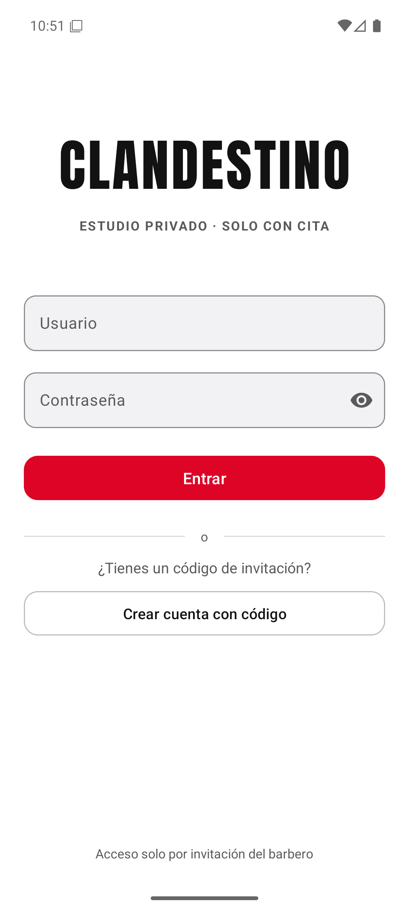 | 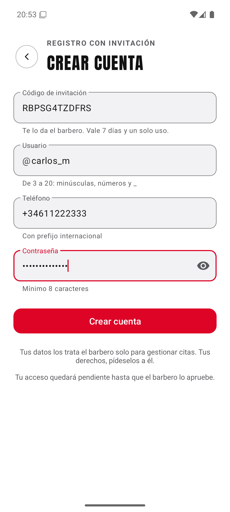 | 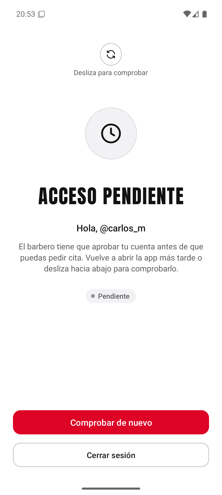 |
| *Figura II.1. Entrada* | *Figura II.2. Registro con código* | *Figura II.3. Acceso pendiente* |

*Fuente de las figuras II.1 a II.3: elaboración propia.*

## II.2 Cliente

El panel del cliente tiene tres pestañas en la barra inferior: «Mis citas», «Pedir» y «Ajustes».

**Mis citas** (figura II.4). Muestra las próximas citas y, debajo, el historial. Cada tarjeta indica el día, la hora y el estado (pendiente, confirmada, hecha, cancelada...). Una cita pendiente o confirmada se puede anular con «Cancelar solicitud» o «Cancelar cita». La app pide confirmación antes de hacerlo y la hora queda libre para otro cliente. Para ver si el barbero ya ha confirmado una cita, se pulsa el botón de recargar o se desliza la lista hacia abajo.

**Pedir cita** (figura II.5). El calendario enseña las dos próximas semanas:

- Un día con borde está libre.
- Un día con fondo gris está completo.
- Un día con borde azul es de vacaciones.
- El borde rojo marca el día de hoy.
- Los días sin borde están cerrados y no se pueden elegir.

Al tocar un día libre aparecen sus horas. Se elige una y se pulsa el botón «Pedir cita», que repite el día y la hora para evitar errores. La cita queda pendiente hasta que el barbero la confirme. Si otra persona ha cogido esa hora un instante antes, la app avisa y vuelve a cargar las horas libres.

**Ajustes** (figura II.6). Muestra la cuenta y su estado y permite elegir entre tema claro y oscuro y cerrar la sesión.

| | | |
|---|---|---|
| 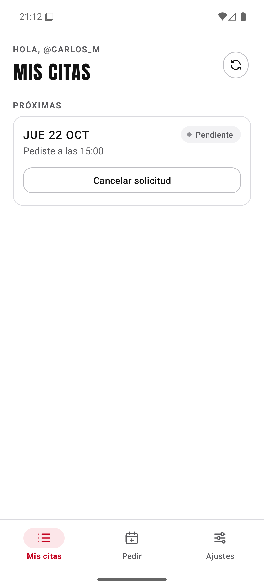 |  | 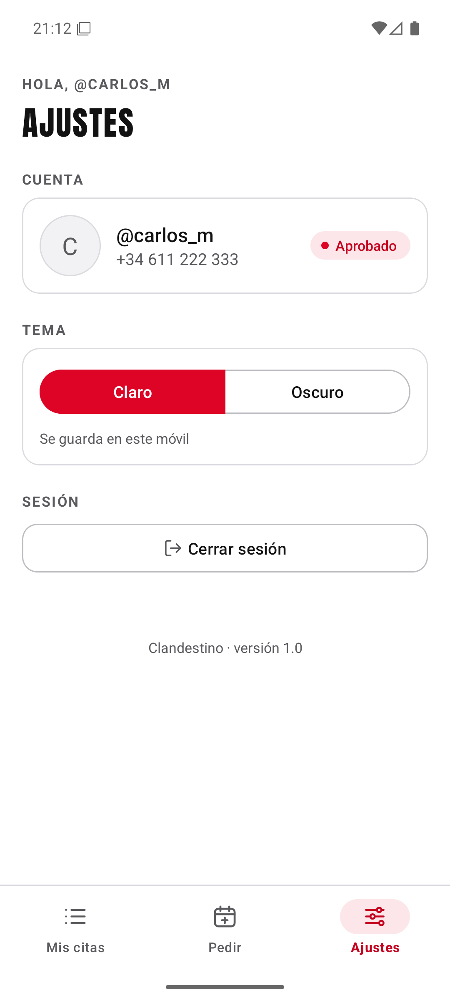 |
| *Figura II.4. Mis citas* | *Figura II.5. Pedir cita* | *Figura II.6. Ajustes* |

*Fuente de las figuras II.4 a II.6: elaboración propia.*

## II.3 Barbero

El panel del barbero tiene cuatro pestañas: «Solicitudes», «Agenda», «Horarios» y «Clientes». Para cerrar la sesión se usa el botón de salida que hay arriba en «Clientes».

**Solicitudes** (figura II.7). Lista las citas pendientes con el cliente, el día y la hora que pidió. En «Hora final» se puede dejar esa hora o elegir otra del mismo día. Después se pulsa «Confirmar» o «Rechazar». Si la hora elegida ya está ocupada por otra cita, la app lo avisa y no confirma.

**Agenda** (figura II.8). Muestra la semana con flechas para avanzar o retroceder. Los días que tienen citas llevan un punto rojo. Al tocar un día se ven sus citas confirmadas con la hora, el cliente y su teléfono. Cuando la hora de una cita ya ha pasado, se activan «Asistió» y «No vino». Una cita futura se puede cancelar.

| | |
|---|---|
| 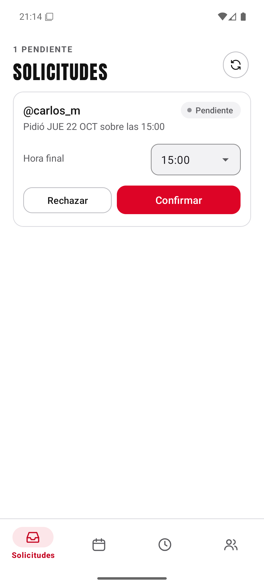 | 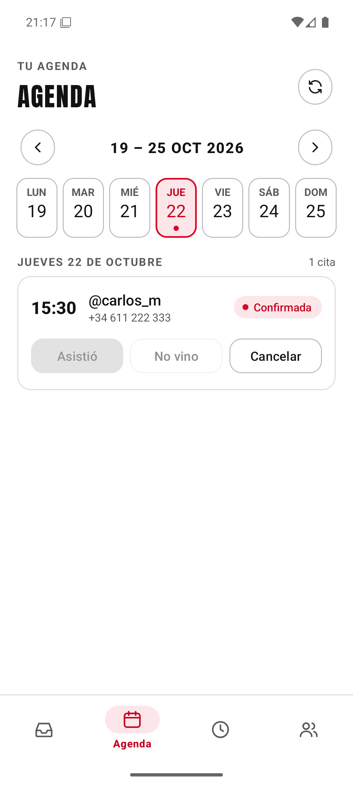 |
| *Figura II.7. Solicitudes* | *Figura II.8. Agenda* |

*Fuente de las figuras II.7 y II.8: elaboración propia.*

**Horarios** (figura II.9). En la plantilla semanal cada día tiene un interruptor para abrirlo o cerrarlo, su hora de inicio, su hora de fin y su cupo, que es el número máximo de citas de ese día. Al tocar una hora se abre un reloj, y al tocar el cupo, un selector. Los cambios se aplican al pulsar «Guardar».

Debajo, en «Vacaciones y días extra», el botón «Añadir» abre un diálogo con dos opciones (figura II.10):

- **Vacaciones**: se elige un día o un rango de días en el calendario y quedan cerrados.
- **Día extra**: se elige un día, su horario y su cupo. Sirve para abrir un día que normalmente está cerrado o para cambiar el horario de un día concreto.

Las vacaciones y los días extra aparecen en una lista (figura II.11), mandan sobre la plantilla semanal y se pueden borrar con la cruz de cada fila.

| | | |
|---|---|---|
| 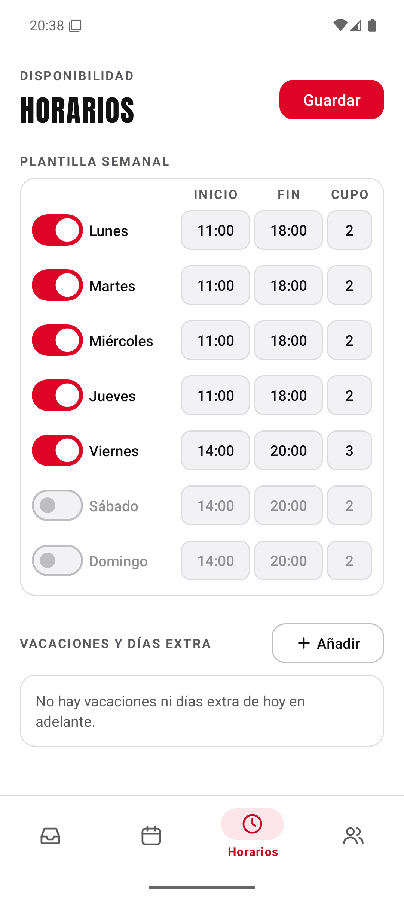 | 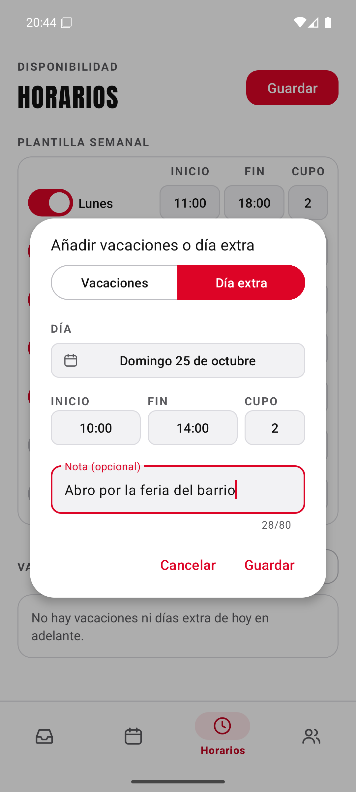 | 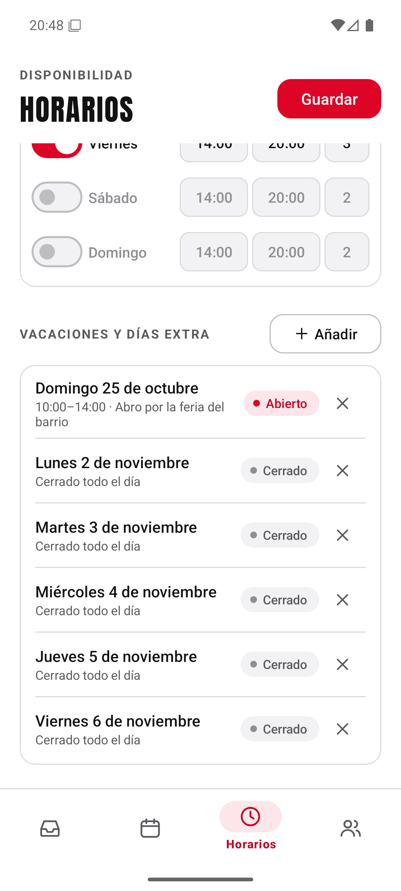 |
| *Figura II.9. Horarios* | *Figura II.10. Día extra* | *Figura II.11. Vacaciones y días extra guardados* |

*Fuente de las figuras II.9 a II.11: elaboración propia.*

**Clientes** (figuras II.12 y II.13). En «Invitar a un cliente» se escribe una nota opcional para recordar a quién va dirigido el código, por ejemplo «Primo de Dani», y se pulsa «Generar». El código aparece con un botón para copiarlo y enviarlo al cliente por el medio que se prefiera. Debajo se listan las invitaciones con su estado (pendiente, usada o caducada), y en las usadas aparece qué @usuario se registró con ella. Al final están los clientes registrados, que se pueden aprobar o bloquear. Un cliente bloqueado no puede pedir citas, pero las que ya tenía no se borran.

| | |
|---|---|
| 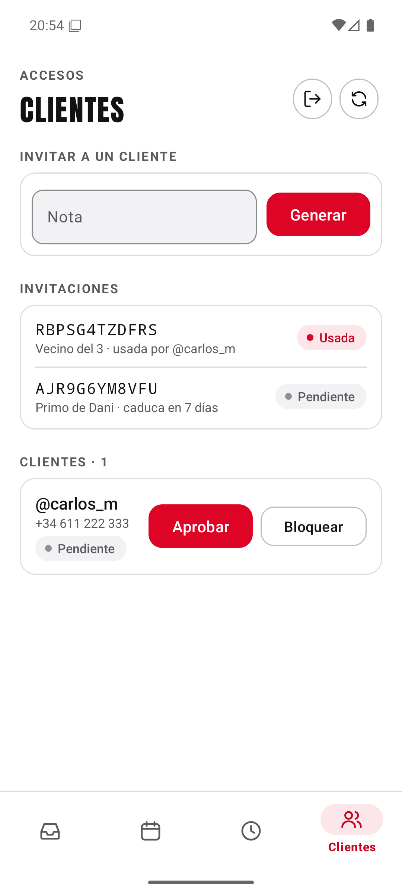 | 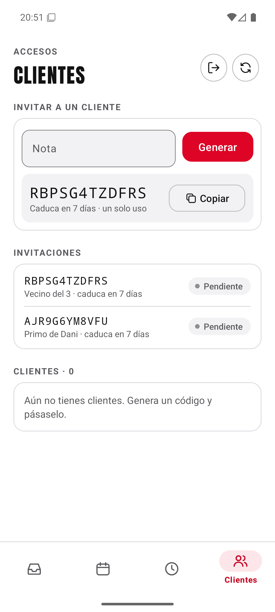 |
| *Figura II.12. Clientes* | *Figura II.13. Código recién generado* |

*Fuente de las figuras II.12 y II.13: elaboración propia.*
