# Anexo III. Documentación técnica de diseño

Este anexo recoge el material de diseño que no cabe en el cuerpo de la memoria: la descripción completa de los diez casos de uso, su trazabilidad con pantallas, rutas de la API y requisitos, los diagramas de clases y de secuencia a tamaño completo y los mockups que no aparecen en la figura 2.

Los códigos de error que aparecen en los casos de uso son los que devuelve la API en el campo `error` de la respuesta, con el código HTTP entre paréntesis. Las pantallas se nombran como en los mockups: A1 a A3 para el acceso, C1 a C3 para el cliente y D1 a D4 para el barbero.

## III.1 Descripción de los casos de uso

| UC01 | Registrarse con código |
|---|---|
| **Actor** | Visitante |
| **Precondición** | Tiene un código de invitación vigente que le ha dado el barbero. |
| **Flujo básico** | 1. Abre A2, lee el aviso de privacidad y escribe código, @usuario, teléfono y contraseña. 2. La app valida el formato mientras escribe. 3. Envía `POST /api/auth/registro`. 4. La API comprueba la invitación y crea el usuario con rol `cliente` en estado `pendiente`. 5. La API devuelve el token y los datos del usuario. 6. La app guarda la sesión y muestra A3. |
| **Alternativos y errores** | 4a. Formato incorrecto: `datos_invalidos` (400). 4b. Código inexistente: `invitacion_invalida` (400). Ya usado: `invitacion_usada` (409). Pasado de fecha: `invitacion_caducada` (409). 4c. @usuario o teléfono ya registrados: `duplicado` (409), y la invitación no se gasta. 4d. Demasiados intentos seguidos: `demasiados_intentos` (429). |
| **Postcondición** | Existe un cliente `pendiente`, la invitación queda `usada` con el nuevo usuario en `usada_por` y hay una sesión iniciada. |

*Tabla III.1. Caso de uso UC01. Fuente: elaboración propia.*

| UC02 | Iniciar sesión |
|---|---|
| **Actor** | Cliente o barbero (usuario registrado) |
| **Precondición** | Tiene cuenta, en cualquier estado. |
| **Flujo básico** | 1. Abre A1. Si hay un token guardado y `GET /api/yo` lo acepta, este paso se salta. 2. Escribe @usuario y contraseña. 3. Envía `POST /api/auth/login`. 4. La API comprueba el hash de la contraseña y devuelve un token. 5. La app lo guarda cifrado y llama a `GET /api/yo`. 6. Según el rol y el estado, el barbero va a D1, el cliente aprobado a C1 y el cliente pendiente o bloqueado a A3, que muestra un texto distinto en cada caso. |
| **Alternativos y errores** | 1a. Token guardado rechazado: `token_invalido` (401). La app lo borra y muestra A1. 3a. Campos vacíos: `datos_invalidos` (400). 3b. Usuario o contraseña incorrectos: `credenciales_invalidas` (401), con el mismo mensaje en los dos casos para no revelar qué usuarios existen. 3c. Demasiados intentos: `demasiados_intentos` (429). |
| **Postcondición** | La sesión queda activa. Para cerrarla, el cliente usa «Cerrar sesión» en C3 y el barbero el icono de salida de D4. En los dos casos se borra el token del móvil sin llamar a la API. |

*Tabla III.2. Caso de uso UC02. Fuente: elaboración propia.*

| UC03 | Consultar disponibilidad |
|---|---|
| **Actor** | Cliente |
| **Precondición** | Sesión iniciada y cuenta aprobada. |
| **Flujo básico** | 1. En C2 la app pide `GET /api/dias`. 2. Pinta los 14 días del horizonte como libre, completo o vacaciones. Los cerrados quedan deshabilitados. 3. El cliente elige un día libre. 4. La app pide `GET /api/huecos?fecha=…`. 5. Muestra las horas del día y deshabilita las ocupadas. |
| **Alternativos y errores** | 1a. Cliente pendiente o bloqueado: `no_aprobado` (403). La app muestra A3. 1b. Sesión caducada: `token_invalido` (401). La app vuelve a A1. 4a. Fecha mal escrita: `datos_invalidos` (400). Fuera del horizonte: `fecha_fuera_de_horizonte` (400). \*. Sin conexión, la app muestra un mensaje y deja reintentar. |
| **Postcondición** | No cambia ningún dato. El cliente sabe qué días y horas están libres. |

*Tabla III.3. Caso de uso UC03. Fuente: elaboración propia.*

| UC04 | Solicitar cita |
|---|---|
| **Actor** | Cliente |
| **Precondición** | Cuenta aprobada y un hueco libre elegido en UC03. |
| **Flujo básico** | 1. En C2 pulsa el botón «Pedir cita», que repite el día y la hora. 2. La app envía `POST /api/citas` con `fecha` y `hora_pedida`. 3. La API comprueba horizonte, día abierto, tramo, hora en punto, hora no pasada, cupo y hueco, en ese orden. 4. Guarda la cita en estado `pendiente`. 5. Responde 201 con la cita. 6. La app avisa de que la solicitud se ha enviado y la cita aparece como pendiente en C1. |
| **Alternativos y errores** | 3a. `fecha_fuera_de_horizonte`, `hora_fuera_de_tramo`, `hora_invalida` o `hora_pasada` (400). 3b. `dia_cerrado`, `dia_lleno` o `hueco_ocupado` (409). La app vuelve a cargar los huecos. 3c. Formato incorrecto: `datos_invalidos` (400). 3d. Cliente no aprobado: `no_aprobado` (403). |
| **Postcondición** | Hay una cita nueva `pendiente` que ocupa su hora y cuenta para el cupo hasta que el barbero decida. |

*Tabla III.4. Caso de uso UC04. Fuente: elaboración propia.*

| UC05 | Gestionar mis citas (ver y cancelar) |
|---|---|
| **Actor** | Cliente |
| **Precondición** | Cuenta aprobada. |
| **Flujo básico** | 1. En C1 la app pide `GET /api/mis-citas`. 2. Muestra una tarjeta por cita con el día, la hora y el estado escrito, sin precio ni propina. 3. En una cita pendiente o confirmada, el cliente pulsa cancelar. 4. La app pide confirmación en un diálogo. 5. Envía `POST /api/citas/{id}/cancelar`. 6. La cita pasa a `cancelada` y la lista se recarga. |
| **Alternativos y errores** | 5a. Cita de otro cliente o inexistente: `no_encontrado` (404). 5b. La cita ya no está activa: `estado_invalido` (409). 5c. La hora de la cita ya ha pasado: `cita_pasada` (409). 5d. `no_aprobado` (403) o `token_invalido` (401), igual que en UC03. |
| **Postcondición** | La cita queda `cancelada` y su hora y su plaza del cupo se liberan en ese momento. |

*Tabla III.5. Caso de uso UC05. Fuente: elaboración propia.*

| UC06 | Generar invitación |
|---|---|
| **Actor** | Barbero |
| **Precondición** | Sesión de barbero. |
| **Flujo básico** | 1. En D4 escribe una nota opcional y pulsa «Generar». 2. La app envía `POST /api/admin/invitaciones`. 3. La API crea un código aleatorio de 12 caracteres, válido 7 días y de un solo uso. 4. La app muestra el código con un botón para copiarlo. 5. D4 recarga la lista con `GET /api/admin/invitaciones`. Cada fila lleva el código, la nota y el estado (pendiente, usada o caducada), y la nueva aparece como pendiente. «Caducada» no se guarda en la base de datos, sino que la API la calcula para las pendientes cuya fecha de caducidad ya ha pasado. |
| **Alternativos y errores** | 2a. Nota de más de 60 caracteres: `datos_invalidos` (400). 2b. Sesión de cliente: `sin_permiso` (403). 2c. Sesión caducada: `token_invalido` (401). |
| **Postcondición** | Existe una invitación `pendiente` creada por el barbero que caduca a los 7 días. |

*Tabla III.6. Caso de uso UC06. Fuente: elaboración propia.*

| UC07 | Aprobar o bloquear cliente |
|---|---|
| **Actor** | Barbero |
| **Precondición** | Sesión de barbero y al menos un cliente registrado. |
| **Flujo básico** | 1. En D4 la app pide `GET /api/admin/clientes`. 2. El barbero elige un cliente y pulsa aprobar o bloquear. 3. La app envía `POST /api/admin/clientes/{id}/aprobar` o `POST /api/admin/clientes/{id}/bloquear`. 4. La API cambia el estado y, si aprueba, guarda la fecha en `aprobado_en`. 5. La lista se actualiza. |
| **Alternativos y errores** | 3a. Cliente inexistente: `no_encontrado` (404). 3b. Ya estaba en ese estado: `estado_invalido` (409). 3c. Sesión de cliente: `sin_permiso` (403). |
| **Postcondición** | El nuevo estado se aplica desde la siguiente petición del cliente. Sus citas no se tocan. |

*Tabla III.7. Caso de uso UC07. Fuente: elaboración propia.*

| UC08 | Gestionar solicitudes (confirmar o rechazar) |
|---|---|
| **Actor** | Barbero |
| **Precondición** | Hay citas pendientes. |
| **Flujo básico** | 1. En D1 la app pide `GET /api/admin/citas?estado=pendiente`. 2. Cada tarjeta muestra el @usuario, el día y la hora pedida. 3. El barbero deja la hora pedida o elige otra hora final del mismo día. 4. Confirma con `POST /api/admin/citas/{id}/confirmar` o, tras un diálogo, rechaza con `POST /api/admin/citas/{id}/rechazar`. 5. La cita pasa a `confirmada` o `rechazada` y desaparece de la lista. |
| **Alternativos y errores** | 4a. Otra cita activa a esa hora: `hueco_ocupado` (409). 4b. La cita ya no está pendiente: `estado_invalido` (409). Su hora ya ha pasado: `cita_pasada` (409). 4c. Hora final con formato o rango incorrectos: `datos_invalidos` (400). 4d. Cita inexistente: `no_encontrado` (404). |
| **Postcondición** | La cita queda `confirmada` con su `hora_final` y la fecha de la decisión, o `rechazada`, que libera la hora y la plaza del cupo. |

*Tabla III.8. Caso de uso UC08. Fuente: elaboración propia.*

| UC09 | Gestionar la agenda (asistencia y cancelación) |
|---|---|
| **Actor** | Barbero |
| **Precondición** | Hay citas confirmadas. |
| **Flujo básico** | 1. En D2 la app pide las citas confirmadas de la semana visible con `GET /api/admin/citas?estado=confirmada&desde=…&hasta=…`. 2. El barbero toca un día y elige una cita. 3. Si su hora ya ha pasado, pulsa «Asistió» o «No vino», que envía `POST /api/admin/citas/{id}/asistencia` con el `resultado`. 4. Si es futura, pulsa cancelar y lo confirma en el diálogo, que envía `POST /api/admin/citas/{id}/cancelar`. 5. La cita deja de estar confirmada y sale de la agenda al recargar. |
| **Alternativos y errores** | 3a. Asistencia antes de la hora de la cita: `cita_futura` (409). 3b. `resultado` desconocido: `datos_invalidos` (400). 4a. Cancelar una cita que ya ha pasado: `cita_pasada` (409). \*. La cita no está confirmada: `estado_invalido` (409). Cita inexistente: `no_encontrado` (404). |
| **Postcondición** | La cita queda `hecha` (con el precio del corte del cliente copiado en ese momento), `no_asistio` o `cancelada`. Solo la cancelación libera hora y cupo. |

*Tabla III.9. Caso de uso UC09. Fuente: elaboración propia.*

| UC10 | Configurar horarios y vacaciones |
|---|---|
| **Actor** | Barbero |
| **Precondición** | Sesión de barbero. |
| **Flujo básico** | 1. En D3 la app pide `GET /api/admin/horarios` y `GET /api/admin/excepciones`. 2. Para cada día de la semana fija si abre, la hora de inicio, la de fin y el cupo, y guarda con `PUT /api/admin/horarios`. 3. Con «Añadir» crea una excepción. Unas vacaciones cierran uno o varios días seguidos, y un día extra abre una fecha concreta con su propio tramo y cupo. Se guarda con `POST /api/admin/excepciones`. 4. Para quitar una excepción pulsa la cruz de su fila, que envía `DELETE /api/admin/excepciones/{id}`. 5. Los cambios se aplican desde ese momento en UC03 y UC04. |
| **Alternativos y errores** | 2a. Inicio igual o posterior al fin, día de la semana fuera de 1 a 7, cupo fuera de rango, fecha pasada o vacaciones con horas: `datos_invalidos` (400). 4a. Excepción inexistente: `no_encontrado` (404). \*. Sesión de cliente: `sin_permiso` (403). |
| **Postcondición** | El horario y las excepciones quedan actualizados. Una excepción manda sobre el horario semanal en su fecha, y las citas que ya existían no cambian. |

*Tabla III.10. Caso de uso UC10. Fuente: elaboración propia.*

## III.2 Trazabilidad

La tabla III.11 relaciona cada caso de uso con la pantalla donde ocurre, las rutas de la API que usa y los requisitos funcionales que cubre. Así se comprueba que no queda ningún requisito sin caso de uso ni ninguna ruta sin pantalla, salvo `/api/salud`, que solo sirve para comprobar la instalación.

| Caso de uso | Pantalla | Rutas de la API | Requisitos |
|---|---|---|---|
| UC01 Registrarse con código | A2 y luego A3 | `POST /api/auth/registro`, `GET /api/yo` | RF-01, RF-02, RF-03, RF-04, RF-08 |
| UC02 Iniciar sesión | A1 (C3 y D4 para salir) | `POST /api/auth/login`, `GET /api/yo` | RF-04, RF-05, RF-06, RF-07, RF-08 |
| UC03 Consultar disponibilidad | C2 | `GET /api/dias`, `GET /api/huecos` | RF-09, RF-10, RF-11 |
| UC04 Solicitar cita | C2 | `POST /api/citas` | RF-12, RF-13, RF-14 |
| UC05 Gestionar mis citas | C1 | `GET /api/mis-citas`, `POST /api/citas/{id}/cancelar` | RF-15, RF-16 |
| UC06 Generar invitación | D4 | `POST /api/admin/invitaciones`, `GET /api/admin/invitaciones` | RF-17, RF-18 |
| UC07 Aprobar o bloquear cliente | D4 | `GET /api/admin/clientes`, `POST /api/admin/clientes/{id}/aprobar`, `POST /api/admin/clientes/{id}/bloquear` | RF-08, RF-19, RF-20, RF-21 |
| UC08 Gestionar solicitudes | D1 | `GET /api/admin/citas?estado=pendiente`, `POST /api/admin/citas/{id}/confirmar`, `POST /api/admin/citas/{id}/rechazar` | RF-22, RF-23, RF-24 |
| UC09 Gestionar la agenda | D2 | `GET /api/admin/citas?estado=confirmada`, `POST /api/admin/citas/{id}/asistencia`, `POST /api/admin/citas/{id}/cancelar` | RF-25, RF-26, RF-27 |
| UC10 Configurar horarios y vacaciones | D3 | `GET` y `PUT /api/admin/horarios`, `GET` y `POST /api/admin/excepciones`, `DELETE /api/admin/excepciones/{id}` | RF-11, RF-28, RF-29 |
| Sin caso de uso | — | `GET /api/salud` (anexo I) | RF-30 |

*Tabla III.11. Trazabilidad entre casos de uso, pantallas, rutas y requisitos. Fuente: elaboración propia.*

C3 no tiene caso de uso propio, porque cerrar sesión forma parte de UC02 y el cambio de tema es un requisito no funcional de usabilidad. El requisito RF-25 preveía una vista de agenda por semana o por mes, pero solo se construyó la semanal.

## III.3 Diagramas de clases

La figura 8 de la memoria muestra el modelo de la API. Los seis diagramas siguientes completan el resto de capas y se generaron a partir de las clases compiladas, de modo que los nombres coinciden con el código. Cada uno agrupa las clases por paquete.

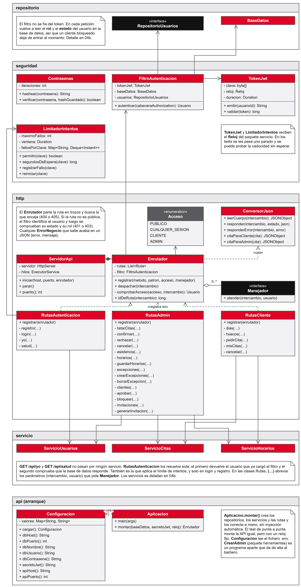

*Figura III.1. API: arranque, capa HTTP con el enrutador y las rutas, y seguridad (contraseñas, token JWT, filtro y limitador de intentos). Fuente: elaboración propia.*

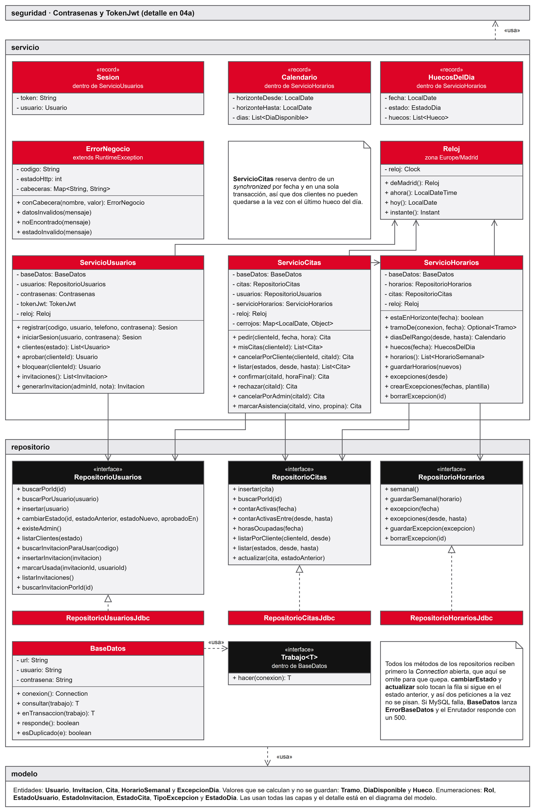

*Figura III.2. API: servicios de negocio, errores y repositorios. Fuente: elaboración propia.*

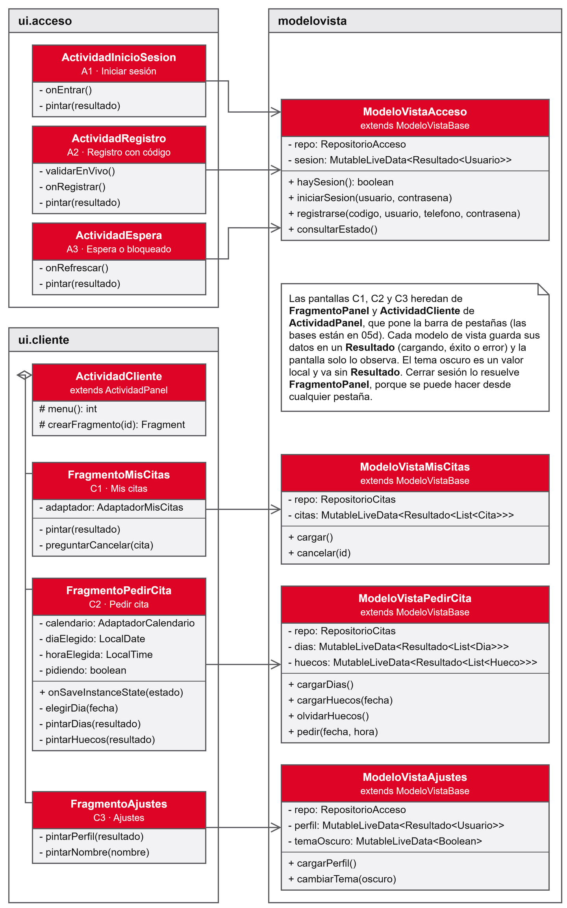

*Figura III.3. App: pantallas de acceso y del cliente con sus ModeloVista. Fuente: elaboración propia.*

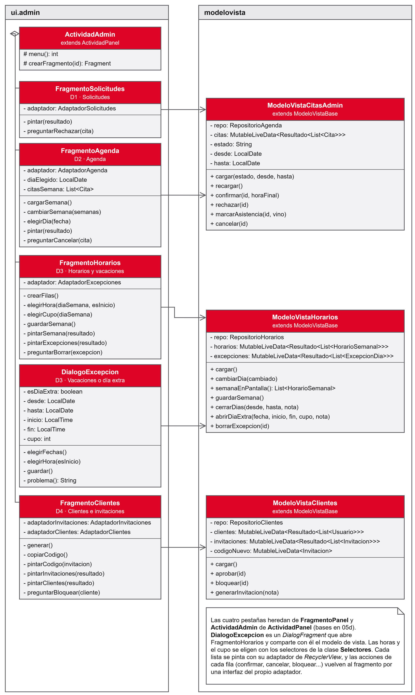

*Figura III.4. App: pantallas del barbero con sus ModeloVista. Fuente: elaboración propia.*

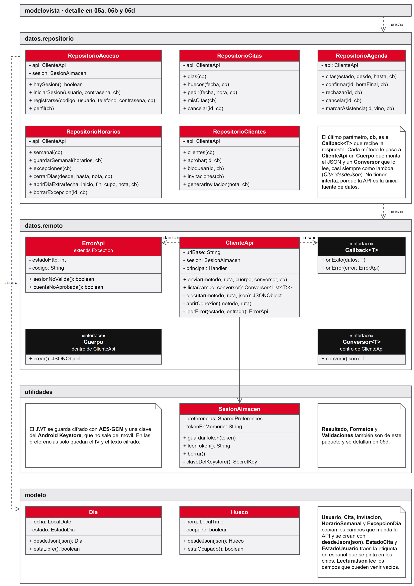

*Figura III.5. App: repositorios, cliente HTTP y almacén cifrado de la sesión. Fuente: elaboración propia.*

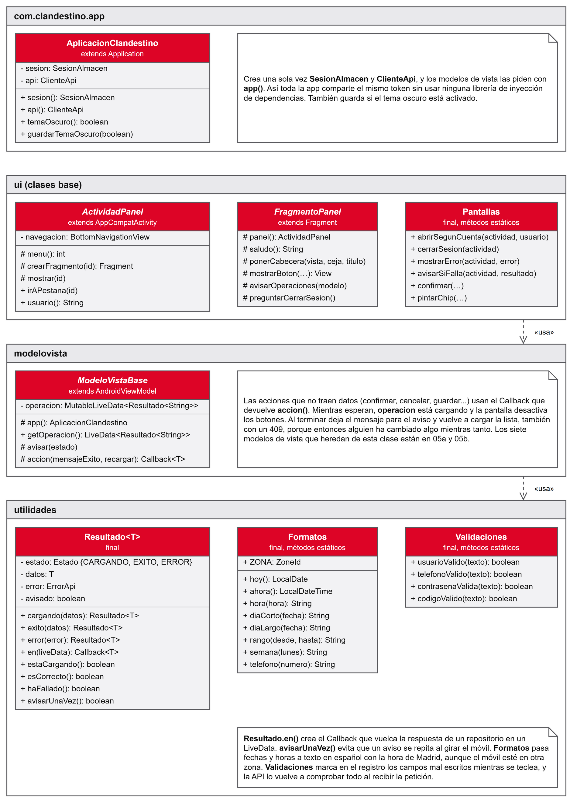

*Figura III.6. App: clase Application y clases base de actividades y fragmentos. Fuente: elaboración propia.*

## III.4 Diagramas de secuencia de «Solicitar cita»

El caso UC04 es el que atraviesa todas las capas, así que se dibujó entero, desde que el cliente pulsa el botón hasta que la cita queda guardada. Por tamaño se partió en cinco diagramas. El último, la inserción con el cerrojo por fecha, es la figura 9 de la memoria. Los otros cuatro van aquí.

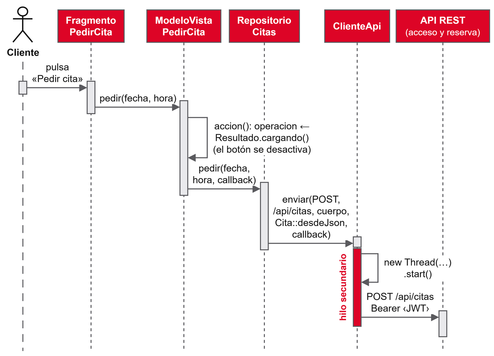

*Figura III.7. App, envío. El fragmento llama al ModeloVista, que pasa la petición al repositorio y este la lanza en un hilo aparte. Fuente: elaboración propia.*

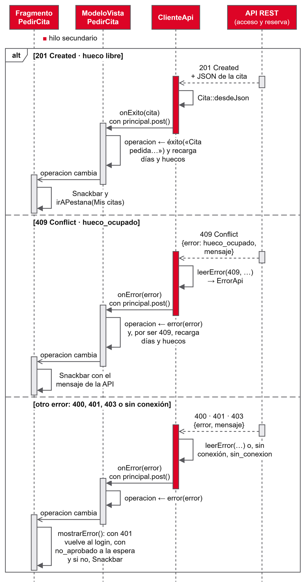

*Figura III.8. App, respuesta. El resultado vuelve al hilo principal y el fragmento reacciona de tres formas: cita creada, hora ya ocupada (recarga los huecos) u otro error. Fuente: elaboración propia.*

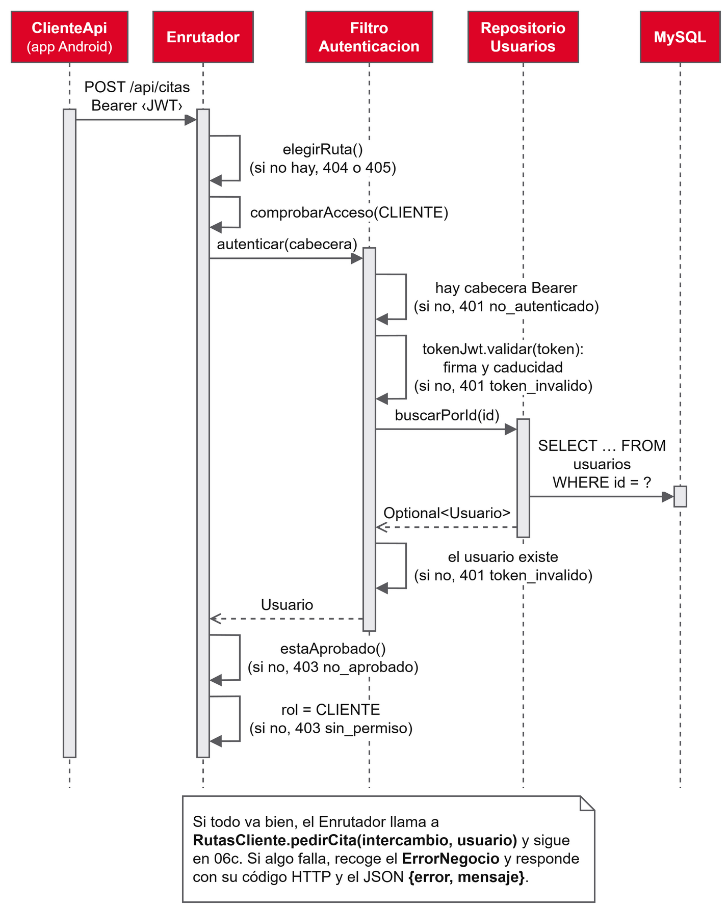

*Figura III.9. API, acceso. El enrutador elige la ruta, el filtro valida el token y busca al usuario, y el enrutador comprueba que es un cliente aprobado. Fuente: elaboración propia.*

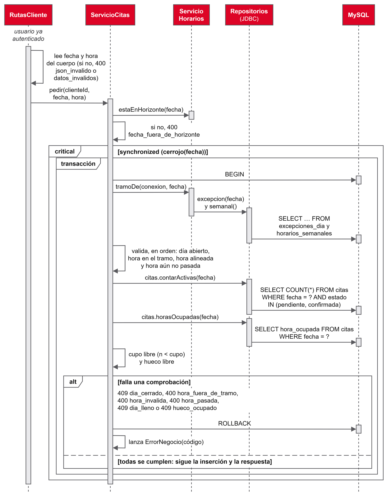

*Figura III.10. API, validación. Dentro del cerrojo de la fecha y de la transacción, el servicio comprueba horizonte, tramo, hora, cupo y hueco antes de reservar. Fuente: elaboración propia.*

## III.5 Mockups restantes

La figura 2 de la memoria reúne seis de los once mockups. Estos son los otros cinco: el registro, las dos variantes de la pantalla de espera, los ajustes y la pantalla de clientes e invitaciones.

| | | |
|---|---|---|
| 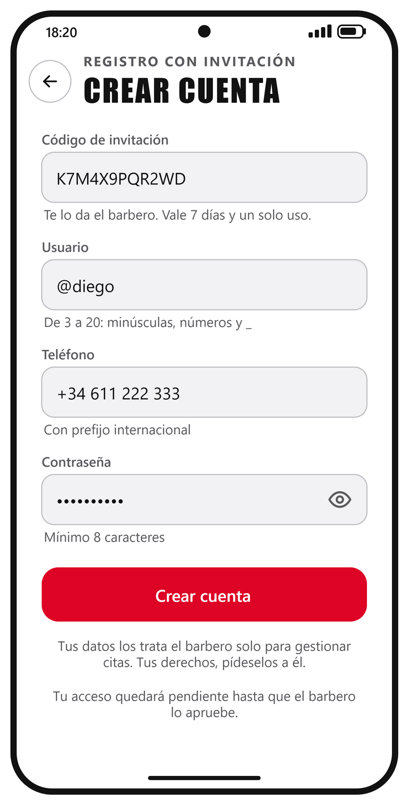 | 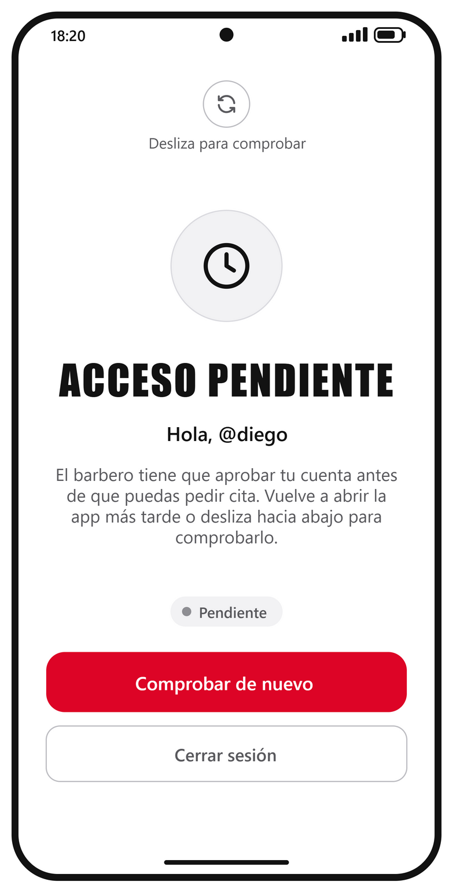 | 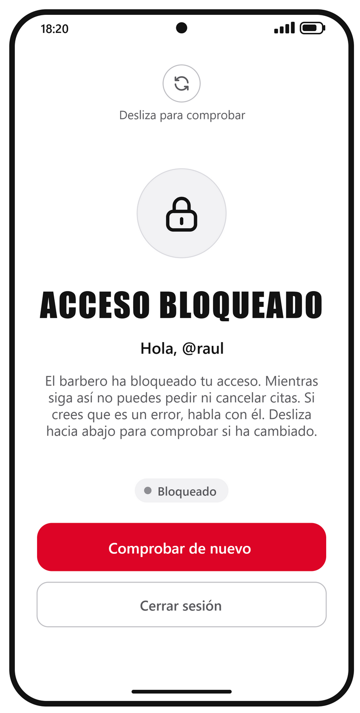 |
| *Figura III.11. A2, registro con código* | *Figura III.12. A3, cuenta pendiente* | *Figura III.13. A3, cuenta bloqueada* |

| | |
|---|---|
| 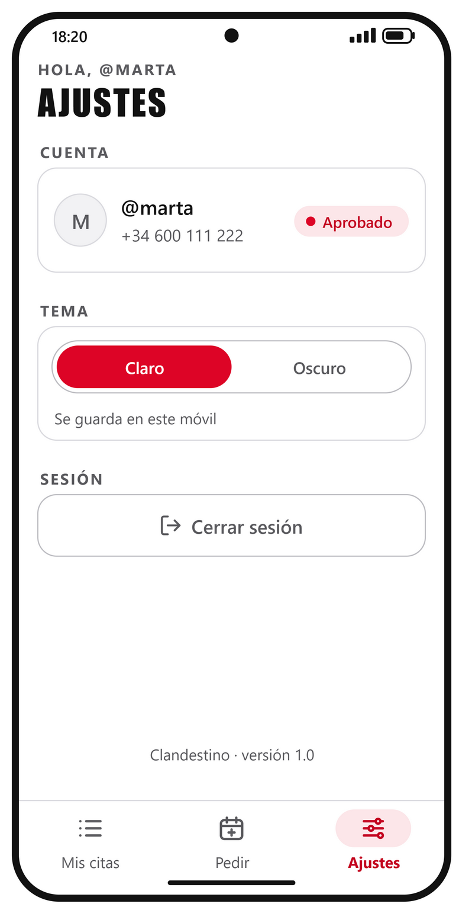 | 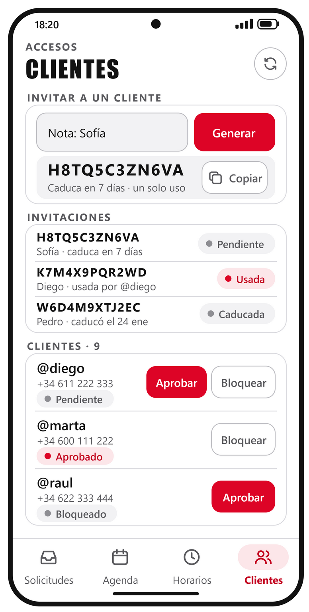 |
| *Figura III.14. C3, ajustes* | *Figura III.15. D4, clientes e invitaciones* |

*Fuente de las figuras III.11 a III.15: elaboración propia.*
